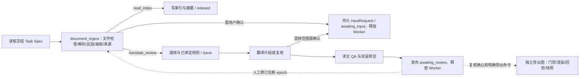

# 后端开发方案：单证工作流、模型与交付闭环

2026-10-08 导出契约：交付物是当前确认版本的纯目标语言译本（所选 DOCX/PDF），可选各原件的识别稿 PDF；不生成复核报告。识别稿从冻结 ParseArtifact 的原文与布局生成，不冒充 MinerU 供应商原始 PDF。一个 Run 对应一个目标语言；其他语言使用各自 Run/确认/快照独立导出，当前不提供多语言一键批量翻译或导出。旧成功快照含报告只作接口兼容，不再展示报告下载；旧失败报告清单在原 Attempt 安全重试时升级为译本与识别稿，历史失败事件保留。

版本：v0.1｜基线 2026 年 9 月 28 日｜状态：实施基线，已有业务代码；实际交付及未实现项以 D0–D7 台账和 2026-10-02 逐条核验记录为准。

上位依据：[单证翻译校验工作台与工作流产品设计](../../需求设计/单证翻译校验工作台与工作流_产品设计.md)、[对话产品设计](../../需求设计/对话工作台与对话Agent_产品设计.md)、[单据管理台产品设计](../../需求设计/单据管理台_产品设计.md)、[工程技术方案](../../技术方案/物流单证智能体_工程技术方案.md)、[前端校验工作台设计](../前端/前端页面设计_单证校验工作台.md)与[前后端接口与状态契约](../../技术方案/前后端接口与状态契约.md)。对话层与统一 Prompt Registry 见[Agent 与提示词方案](后端开发方案_Agent与提示词.md)，表结构和 API 路由实现见[数据存储与接口方案](后端开发方案_数据存储与接口.md)。公开 URL、DTO、错误码及 SSE 以共享契约为准；本文规定它们背后的实现顺序、数据依赖和失败恢复。

## 1. 一句话执行模型与首版边界

`read_index@1` 与 `translate_review@1` 共享“原件检查 → 解析/OCR → 逻辑单据/区段 → 字段和行项目 → 来源核验”子图。只读流程写有证据的索引后进入 `indexed`；翻译流程继续执行通用字段与跨单据核对、受保护片段翻译、译文 QA、双语预览，随后释放 Worker 并进入人工复核。人工修订在业务事务中生成新版本和失效依赖，同一 Run 的新 `ExecutionEpoch` 只重算失效项；复核确认与正式导出是独立业务命令，整组回检通过后才登记 Export Snapshot。

对话模型只负责意图、澄清和解释，不处理附件。单证工作流可以通过统一 Model Gateway 调用 `EXTRACT/TRANSLATE/VISION`，但每个模型结果仅是可校验的候选或译段，原件、规范值、规则结论、人工采用值与导出资格由领域服务决定。首版通用物流单证解析、翻译和可证明同口径的跨单据一致性检查覆盖发票、箱单、提单和其他佐证材料；线路/货类法规仅在已有来源、有效期、适用条件及审核人的**生效规则包**范围内运行。没有经过审核的适用规则时给 `not_covered/undetermined`，不得编造证书义务或写“合规通过”。

### 1.1 现有骨架上增加什么

| 位置 | 保留/补齐的代码 | 验收作用 |
| --- | --- | --- |
| `app/router/contracts.py` | 保留 `ReadIndexTaskSpec`、`TranslateReviewTaskSpec` 判别联合模型；补 TaskDraft/澄清校验服务，不改变运行后不可变性。 | 主卡、直接上传和自然语言统一路由。 |
| `app/workflows/registry.py`、`graphs.py`、`state.py` | 保留现有两个工作流和 `document_ingest` 子图构造入口；加必要的条件边和节点服务注入；导出仍为单独 `build_export_graph`。 | Worker 只运行已注册图，后续工作流不复制整套上传/事件。 |
| `app/documents/` | 新增文件检查、解析适配、锚点、逻辑单据、字段/行、规则、翻译、QA、预览、正式渲染与回检。 | 单证处理事实由此产出，按 ID 持久化。 |
| `app/review/` | 在现有确认/兼容/核查契约上实现修订影响预览、字段确认、无法判断、Issue 处置、版本配对门禁、ReviewConfirmation 和整组快照。 | 校验页各独立按钮都得到独立命令和审计。 |
| `app/infra/` | Postgres 领域事务、S3/MinIO 对象仓储、Model/MinerU Gateway、Celery Outbox、步骤账本、租约/恢复扫描器和 LangGraph checkpointer。 | 数据库为业务真值；队列和图检查点只负责执行恢复。 |
| `app/search/` | 从已落库字段、Issue、RunEvent 构造有版本的摘要/检索投影。 | 管理台和 `@ `快速定位；摘要不能代替证据。 |

不新建“解析 Agent”“翻译 Agent”“审单 Agent”三个自由代理。现有图节点已足够表达首版主线，新增逻辑写在有输入输出的领域步骤服务里，避免把同一问题在 LangGraph、Celery 和 API 三处重复判定。

## 2. 开工输入、协议探测与不可虚构的能力

阶段 0 先用获授权或脱敏样本固定字段 schema、正常差异与植入错误真值。样本至少有图片箱单、原生/扫描/混合 PDF、DOCX、长表/跨页表、同一 PDF 内不同逻辑单据、模糊局部、多语言混排，并覆盖不同运输线路、不同货类及其常见发票／箱单／提单写法。一般识别、字段来源和翻译能力应在这些多样样本上评测；法规／证书规则只对审定规则包的适用线路、货类和生效期断言，不从一般识别覆盖推导合规覆盖。给每份样本标记原件页/段/表/单元格、源段 ID 可对应的真值、预期字段/行、真正冲突与合理角色差异；不要用本轮调 Prompt 的同一材料声称泛化效果。上线前从这些样本确定支持的最大文件/页数、翻译语言（首版中文与英文）、可用坐标精度、版式模板和回检阈值。

用户已确定四类模型按 **OpenAI 兼容协议**接入，Key 与模型名稍后填项目 `.env`；实际 JSON Schema、图片输入、超时、token/费用和流式能力必须逐角色探测，不能因“兼容”二字推定全部支持。OCR 首接 MinerU，Key 同样稍后填 `.env`；实测它在物流样本上返回的表格、阅读顺序、页/块坐标、旋转图位置、异步任务键、错误/限流语义。若某项不满足，替换解析适配器或缩小可支持边界，领域层 `ParseArtifact/SourceAnchor` 契约不变。没有凭据时可以完成纯数据模型与假服务契约测试，但真实 OCR/模型链路应显示“待接入验证”，不能当作已实现。

通用规则应优先覆盖有确定性依据的材料覆盖、字段形式、金额算术、包装计量、同口径数量/重量/柜号、角色映射和日期地点关系；哪些实际启用要随测试样本、规则版本一项项签收。法规小包的来源链接或文件、适用国家/线路/品类、有效期、审核人和生效版本必须先落库/配置并人工审核；规则包未发布时相关界面只出现“未覆盖”，不能通过模型联网编造法条。原件是提单/证书时译本必须标“翻译件，供业务复核”，不生成貌似重新签发的有效原件。

## 3. Task Draft、Task Spec 与 Run 的事务边界

`POST /api/v1/task-drafts` 会**持久化可编辑草稿，并只做不收费的确定性校验**：按已注册 `WorkflowDefinition` 与权限核对 Case、已成功上传的原件版本、目标语言、翻译范围、所选区段、格式、归票状态及规则/术语配置。缺项保存并返回合并的澄清问题与选项；完整时返回 `draft_task_id`、可见摘要、`expires_at` 和 `draft_version`。此阶段不调用 OCR／模型、不创建 Run 或派发处理任务。草稿创建带 `Idempotency-Key`，`PATCH /api/v1/task-drafts/{id}` 同时带幂等键与 `expected_draft_version`，只更新尚未运行的草稿；`DELETE /api/v1/task-drafts/{id}` 同时带幂等键与 `expected_draft_version`，先鉴权再查幂等记录，同键重复返回同一 `204`，首次命令才锁定草稿比较版本，仅给未启动草稿写内部 `discarded_at` 并留审计。已启动草稿撤销返回 `409 TASK_DRAFT_ALREADY_STARTED`；撤销后 GET 返回 `404 TASK_DRAFT_NOT_FOUND`，已验收原件仍归 Case。改变已启动 Run 输入必须新建草稿/Run。`POST /api/v1/runs` 只接服务器签发的完整草稿 ID、`expected_draft_version` 和 `Idempotency-Key`，不接受模型临时拼出的步骤列表；事务内锁定草稿，再次查权限、草稿未撤销且有效、文件归票、配置可用性及每个选区引用的当前解析基线。解析版已变化时返回 `409 TASK_DRAFT_PARSE_STALE`、旧/新解析引用与重新选择入口，不按同名区段自动映射；已撤销返回 `409 TASK_DRAFT_DISCARDED`。通过后才写不可变 Task Spec、Run/RunDocument、固定同一解析基线的初始 ExecutionEpoch、首条 RunEvent 和 QueueOutbox，并写 `started_run_id`；数据库约束保证一草稿最多一个 Run。事务提交后再由 Outbox 投递队列，同键重试回同 Run，另一键并发启动返回 `409 TASK_DRAFT_ALREADY_STARTED` 与有权的原 Run ID。

共同 Task Spec 包含 `case_id、workflow_type/version、source_versions[]、initiated_by、created_at、idempotency_key`。只读另含 `index_scope`；翻译另含 `target_language ∈ {zh-CN,en}`、`translation_scope ∈ {all,goods_description,selected_sections}`、`selected_section_refs[]`、`scope_selector_version?`、`output_formats ⊆ {docx,pdf}` 至少一种、`glossary_version、rule_pack_version`。每个 `selected_section_refs[]` 元素固定 `document_id、document_version、parse_artifact_id、logical_document_id、section_id`；TaskDraft 同样保存这些结构化引用及所见解析基线，供刷新／冲突后恢复表单。`goods_description` 在 W03 固定 `cargo_description@1` 语义选择器版本，实际命中的源段须在解析后写 `ResolvedTranslationScope`，不能根据同名标题动态重选。默认整份可读正文及表格、逐原件目标语言 DOCX+PDF 及可选的逐源识别稿 PDF，但界面必须展示默认，不能悄悄生成单语模板。`selected_sections` 要求非空且全部属于参与原件当前有效解析版本；尚未解析不能凭文本猜区段，先做只读识别或请用户选可结构化范围。Run 的 source_versions **就是固定参与集合**，部分上传失败不得进入；同一 SourceDocument 不重复列入。Task Spec 做稳定序列化并哈希，运行后不修改。安全重试和字段修订重算属于同 Run，文件版本、语言或任务范围变更另建 Run。

`ExecutionEpoch` 是 Run 内一次初处理、重算或导出的执行批次，冻结任务哈希、图/节点版本、输入业务/解析版本、所需非秘密 ModelBinding、Prompt 版本和目的。后续 Epoch 默认继承该 Run 已冻结的 Prompt 版本和 ModelBinding；O02 只允许受控迁移模型绑定，Prompt／工作流契约升级须新 Run，不能因 `.env` 或代码发布静默改写旧 Run。Key 只从当时运行环境读取，不写 Task Spec、图状态、日志或前端。Celery 消息只含 `run_id + execution_epoch`；Worker 从数据库读取冻结定义，在本地注册表找图。若旧端点/模型配置不再可用，暂停并走显式模型迁移或终止，不能静默切换到 `.env` 新默认。仅同服务同模型 Key 轮换且可核对未决外部请求时，可继续安全步骤。

`translation_scope=goods_description/selected_sections` 时，工作台及快照的范围说明必须明确写“仅翻译指定范围”，列出实际选中 SourceSection/字段范围和未翻译区段；未选部分仅在原文/识别稿与工作台范围说明中保留，不生成似是而非的目标语言译段，也不通过“全文翻译覆盖”门禁。QA 只要求冻结范围内的必译片段覆盖，所有未选片段仍须在映射清单中可说明；用户想把未选部分也翻译，须新 TaskDraft/Run。按物理源文件生成交付的规则不意味着把该物理文件所有区段都宣称已翻译。

## 4. LangGraph 结构：图只决定执行顺序，事实及时落库

`RunGraphState` 保留 `run_id、workflow_version、execution_epoch、task_spec_hash、artifact_ids、branch_decision、error_class` 之类短值；原件字节、Markdown、字段、完整 OCR 响应、译文和 Issue 均通过 ID 从领域存储读取。图调用的内部 `thread_id = run:{run_uuid}:epoch:{n}`，命名空间与对话图分开，映射先按租户鉴权。首版 Worker 使用 PostgreSQL 同步 `PostgresSaver`，与 API 对话图的异步 saver 分开初始化；内存 checkpointer 只限无持久化试验。编译与迁移/`setup()` 在部署初始化中明确执行。

首版 Celery prefork Worker 走同步领域 Session、同步 `PostgresSaver` 与同步图调用；每个子进程启动后才建立自己的数据库连接池、HTTP 客户端和解析／模型适配器，不共享 FastAPI 的 AsyncSession、异步客户端或父进程已创建的连接。D0 用样本锁定单文件／单 Run 的大小、页数、文件数及单次图执行时间上限，U02/W03 在启动前拒绝超限输入；一个 Celery 消息只驱动**受该上限约束的一次图执行**。每个文件完成时立即提交 StepExecution、RunEvent 和产物，但 LangGraph 完整检查点只在其 super-step 边界提交，不承诺在节点内部按文件产生检查点。需要人工输入、等待异步供应商任务或到达已验证的阶段边界时，领域状态与 Outbox 记录继续条件并结束本消息；后续消息从固定 Task Spec、步骤账本和有效检查点恢复，已完成文件按输入指纹跳过，不能假设 LangGraph 会自动暂停并续投。Redis broker 的 visibility timeout、Celery `acks_late` 与任务软／硬时限按上述执行上限配置，硬时限必须晚于已受理请求的安全记录窗口；重复消息仍由租约、fence token 和输入指纹去重。若 D0 实测发现此上限无法容纳目标单票，必须在发布前实现显式的按文件／阶段任务拆分及聚合栅栏，不能放开限制让一个 Worker 长时间无界占用。

首版不把每页或每行建长期图节点，也不先引入 LangGraph 动态 `Send` 并行归并。`parse_documents`/`extract_fields` 内按文件以有界并发执行，**每一文件完成就提交产物、StepExecution 和 RunEvent**；节点最终以 Task Spec 文件顺序返回一组已保存 ID。失败重启时先按 `step_key + input_fingerprint` 查账本并复用，不因前半文件已完成而从 `[0]` 再收费。一个节点只写自己的状态键，避免多个并行分支覆盖 `artifact_ids`；未来真用并行图边时，先为共享字段定义确定性的 reducer、排序和状态 schema 版本。

改造现有固定边时，`classify_sections` 写活动 InputRequest 与 `awaiting_input` 的领域事务成功后返回 `branch_decision=awaiting_input`，`document_ingest` 子图必须从该节点条件边直接到子图 `END`，不可继续抽取字段；父图在 `document_ingest` 之后再按数据库中的 Run 状态分支，`awaiting_input` 到父图 `END`，否则 `read_index` 才到 `publish_index`、翻译才到 `validate_documents`。`translate_segments` 如因混排停下，也在事务后以条件边到父图 `END`，不能进入 `quality_and_preview`。只有明确成功的节点返回才走下一边；失败由 Worker 边界捕获成分类错误、步骤账本、RunEvent 和安全状态，导出 `preflight` 未通过时绝不执行 `render`。这些判断以已提交的领域状态为准，图状态中的短 `branch_decision` 只负责路由，不能把旧检查点中的选择当授权。

| 图节点/步骤服务 | 输入、立即持久化的输出 | 条件与事件 |
| --- | --- | --- |
| `load_spec` | 用 Run ID 取 Task Spec/ExecutionEpoch，验证图版本、租户、任务哈希、租约；返回短元数据。 | 不匹配直接停；`queued → processing` 的状态和事件由领域事务写。 |
| `inspect_sources` | 对全部冻结 DocumentVersion 检查对象哈希、魔数、大小/页数/压缩展开上限及可读性；生成逐文件路线和质量候选。 | 不支持文件在启动前拒绝；关键缺页/模糊保留质量 Issue 与重拍入口。 |
| `parse_documents` | 对原生 PDF/DOCX/扫描页走适配器，产生不可覆盖 ParseArtifact、原始响应对象 ID、块/表/行、Markdown 阅读副本和可用锚点。 | 逐文件/已知页数发真实事件；服务不可用可重试，源文不可读不凭模型补全。 |
| `classify_sections` | 在解析版本内建立 LogicalDocument/DocumentSection、类型候选、原页/区域范围及顺序。 | 混合 PDF 可有多张逻辑单据；关键区段边界/类型不清则保存 `InputRequest`、`awaiting_input` 并结束本批次，不持有 Worker。 |
| `extract_fields` | 规则优先、复杂语义模型补候选；持久字段/明细行、原文/规范值、角色、来源和首次基线 BusinessRevision。 | 多候选或无源片段标待复核；不得把 Seller/Shipper、毛重/净重合并。 |
| `verify_sources` | 核对每字段/行/源译待用片段均指向本 ParseArtifact 下正确逻辑单据、区段、原件锚点；记录精度。 | 没有可靠来源的关键候选不升为确认事实；低精度定位显式标 `page_only/paragraph_only`。 |
| `publish_index` | 为 read_index 建版本化字段查询视图、短摘要和索引投影，Run 进入 `indexed`。 | 不跑正式跨单据规则、翻译、复核或导出；关联的延迟问答由 indexed Outbox 后续触发。 |
| `validate_documents` | 待所有参与文件汇合后运行通用规则及已生效小规则包，写 RuleResult、Issue 和来源。 | 规则前提缺失给无法判断/未覆盖；跨文件冲突并列全部来源，不能自动择一。 |
| `resolve_translation_scope → translate_segments` | 依据 Task Spec 与当前 ParseArtifact 写不可变 `ResolvedTranslationScope`（必译源段、未译源段及选择器版），再对必译片段按逻辑单据/区段/表行分组，保护标识、调用翻译模型，写初版 TranslationRevision/Segment 与依赖。 | 货描零命中／多候选或源语言混排影响范围时写对应 `InputRequest` 并暂停；不可凭标题猜货描，也不可跳过已冻结必译源段。 |
| `quality_and_preview` | 运行确定性译文 QA、可选语义疑点，逐物理源文件生成带源译映射的净化 HTML PreviewArtifact 并尝试带水印 PDF，写 QA Issue/预览版本。 | 漏译、数字/编号改写等红项阻断确认稿；HTML 失败不发布可复核草稿，PDF 草稿失败只禁该下载且保留可重试步骤；预览始终标草稿/待确认。 |
| `publish_review` | 汇总当前有效业务/译文配对、问题数、RuleResult 覆盖与预览状态；置 `awaiting_review` 并发事件。 | Worker 结束图执行；人工等待不使用跨天 `interrupt()`。 |
| `preflight → render → verify → commit_snapshot` | 导出命令创建独立 epoch；逐文件所选格式及所选识别稿 PDF 暂存、内容/版面回检，最后事务登记整组快照。 | 导出前及登记时都检查 ReviewConfirmation、版本配对和所有文件成功；任一失败不登记。 |

`awaiting_input` 是处理中的**持久用户输入状态**，与处理完草稿后的 `awaiting_review` 不同。同一 Run 最多一条活动 `InputRequest`，每条只针对一个物理源文件的一版 ParseArtifact；多份需确认文件按 Task Spec 顺序逐条处理，状态为 `active/resolved/superseded/cancelled`，数据库对 `status=active` 建 Run 范围唯一约束。首版 `kind` 有 `document_boundary`、`source_language` 和 `translation_scope`：分别覆盖逻辑单据类型／区段边界及重识别映射、冻结范围内源语言／已是目标语言的区段、`goods_description` 命中零个或多个货描候选时的实际源段集合；以后增加种类必须发布新 schema 版本。请求至少保存 `source_refs`（文件版、解析版、相关逻辑单据/节/源段）、候选和选项、问题、固定 Task Spec 哈希、期望业务/解析版本、状态、创建／处置时间和操作者。首次分类可在基线 BusinessRevision 创建前停下，此时 `expected_business_revision_id=null` 是真实前置条件，resolve 还要比较当前仍无业务版及指定解析版。货描范围确认不得扩大为任意区段翻译；改变 Task Spec 语义要新 Run。

`POST /api/v1/input-requests/{id}/resolve` 是该 Run 在 `awaiting_input` 时回答类型／区段／混排问题的**唯一写入入口**。服务端重新鉴权并锁定 Request、Run 与 Case 当前指针，核对幂等键、答案 schema、固定来源和预期版本；在同一事务写回答与处置、必要的区段／语言业务决策及新 BusinessRevision、RunEvent、新 ExecutionEpoch 与 Outbox，再释放 Worker 继续同 Run。新 Epoch 继承本 Run 的 Prompt 版本和当前有效 ModelBinding，重入时按相同来源／解析指纹复用已完成解析，分类／语言节点读取已提交人工决策后继续，不能再创建同一问题的活动请求。普通 `sections/{id}/assign`、`confirm-language` 等复核命令若命中同一活动请求，必须返回 `409 INPUT_REQUEST_ACTIVE` 及该请求入口，不能另开写入路径与恢复图竞态。若答案试图改变参与文件、目标语言或冻结翻译范围，返回 `409 NEW_RUN_REQUIRED` 与可预填草稿，不部分写入旧 Run，也不自动把旧请求改为 `resolved`；用户明确放弃旧任务时另走取消命令，明确以新 Run 替代时才可审计地置 `superseded`。按文件重识别新建 ParseArtifact，不能把回答当作原件替换。

人工复核长期等待由 Run 状态/Issue/业务版本承接。首版不把校验侧栏维持为一个跨天 `interrupt()`，避免用户改字段后旧节点被恢复并重复外部副作用；若未来某个短时子图用 `Command(resume=...)`，恢复前必须重新鉴权、核版本，并确保该中断节点重入时按步骤账本幂等。

## 5. 解析、锚点、逻辑单据与字段的精确定义

### 5.1 原件路线与 MinerU 薄适配

2026-10-02 官方协议修正约定：按 [MinerU 官方 API 文档](https://mineru.net/apiManage/docs) 使用精准解析 v4：申请 `file-urls/batch`、无认证头 PUT、查询 `extract-results/batch/{batch_id}`、下载 `full_zip_url`。上传成功自动启动解析，不再另发创建任务请求。新任务从 `.env` 读取 `MINERU_MODEL_VERSION`（默认 `vlm`，可选 `pipeline`）和 `MINERU_LANGUAGE`（默认 `ch`，仅接受官网语言包值）；不得省略模型让服务默认为 pipeline，也不得给新任务发送官网未列出的 `auto`。模型/语言/表格/OCR配置在外发前写步骤账本，续查复用原配置；旧任务无配置记录时保持旧 pipeline/auto 指纹，原 batch_id 与暂停预算不改，不借修改配置重传。API Token 支持 KEY/TOKEN 配置名，去除可选 Bearer 前缀后只添加一次。模型版本进入新解析指纹。参考 handwriting-web 的本地地址/绑定网卡不直接复制，实际仍走本项目 `.env` 中的服务地址和凭据。协议修正的真实样件结果回填 D0、D7 和执行台账，不能凭参数修正宣称旧任务已恢复。

上传完成时 API 已按文件魔数、大小、哈希和归票封存 DocumentVersion；Worker 再核对对象存在和哈希，不能信任文件后缀。原生 PDF 用 `pdfplumber` 取文字/表格，用 `pypdfium2` 页渲染；按页检查文字覆盖、阅读顺序和关键表格是否完整，扫描/图片页及原生提取不足的页/区域走 MinerU。DOCX 用 `python-docx` 与受控解包提取正文、表格、页眉页脚、嵌图；拒绝宏/外部链接执行，文本框或绘图区域无法稳定取出时记录未覆盖，不静默遗漏。混合 PDF 按页/区域选择路线，不因第一页有文字层就放弃后续扫描页。

`MinerUAdapter` 对接当前实测协议，提供 `submit/get_status/fetch_result/normalize` 或同步等价接口；域层只接收统一的 `ParsedBlock、ParsedTable/Row/Cell、SourceSegment、SourceAnchor、quality_flags`。原始供应商响应加密/受控存对象存储，记录解析器、配置和服务协议版本、供应商请求键/任务 ID；切换解析器不改领域对象 schema。低质量局部如关键数字不清，可把**原图上可证明的局部裁图**交 `VISION` 作第二转写候选，同时保留 MinerU 与视觉候选及来源；模型一致也不代表原件事实正确，缺可靠依据进 Issue 或人工修订。

`SourceAnchor` 必须有所属 `document_id/version + parse_artifact_id + logical_document_id + section_id + source_segment_id`；位置为原件页和标准坐标系中的矩形，或 DOCX 段落/表格/行/单元格，附 `precision=rect/page_only/paragraph_only/cell/none`、旋转/裁切坐标变换及解析/渲染版本。矩形只在坐标可校准并回原图时保存；坐标不可靠退到真实页/段级，不画猜测红框。Markdown 仅为带段落映射的阅读副本，合并单元格和跨页续表不能靠它恢复事实。PDF/图片预览仍显示原件；DOCX 阅读视图须净化，若有渲染 PDF 页码明确绑定渲染版。

同一 DocumentVersion 每次有效重解析产生**新** `parse_artifact_id`，原件版本不变。成功解析至少形成一个 LogicalDocument；混合 PDF 可在同一页不同区域或跨页形成多个 LogicalDocument，每个有一个或多个有序 DocumentSection。未解析文件暂时没有这些 ID。分类不清可保留 `unknown` 节与候选，禁止把整个混合文件标成唯一“发票”。人工确认类型/区段归属是业务修订：解析层原始边界与旧引用不可覆盖，当前业务版建立新的归属映射并重算相关规则/译文；重新解析则换 ParseArtifact 并重新核验旧锚点映射。

### 5.2 字段、行项目与审计事实

抽取结果先分四层：`source_text` 原件/OCR 转写、`candidate_value` 模型或规则候选、`normalized_value` 按明确单位/日期/金额口径规范化、`adopted_value` 人工确认采用。每个值有角色、来源片段、解析版、逻辑单据/区段、质量状态；首次结构化抽取建立 Case 基线 BusinessRevision，但这不代表人工确认。候选没有真实 SourceSegment 或角色不明时只能标待复核。抽取模型返回 Pydantic 结构化数组，逐项给 `field_key、role、raw_value、source_segment_ids[]、confidence_label/ambiguity`；服务端核对 ID 归属、短摘录包含/支持该值、字段 schema 与单位，不从模型生成一个原件不存在的地址或电话。

主体角色分别保存 Invoice Seller/Buyer、B/L Shipper/Consignee/Notify Party 等，不能按“发件人/收件人”一个字段硬合并。单号、柜号、封条号、HS 等保存字符串和前导零；金额、数量用 `Decimal` 并保留币种、精度和费用口径；包装 `件/箱/托盘` 与净重/毛重分别有单位及层级；日期有事件类型，地点有起运地/承运人接货地/装货港/卸货港/原产地角色。电话、邮箱、地址、货描、船名/航次均可多候选且保留原文。首版字段 schema 跟发票、箱单、提单和其他佐证材料分组，其他佐证未经人工指定角色不加入发票/箱单/提单专属或跨单证规则。

LineItem 在解析版本和 LogicalDocument 内有稳定 ID、行号、单元格及字段来源；跨页续表保留表头、页范围和行映射。LineMatch 可保存一对一、一对多、多对一候选、比较口径和人工确认；首版仅对明确同货品、同单位、同批次的一对一或可证明汇总自动判冲突，复杂关系交人工确认。`source_segment_id` 与 `translation_segment_id` 是多对多关联表，不假设段落一一对应；表格行缺译不得被相邻行覆盖。

## 6. 规则执行：广覆盖的通用核对与有边界的法规包

每条 `RuleDefinition` 要有 `rule_id/version、适用 LogicalDocument 类型与角色、所需字段/来源、比较口径、Decimal 容差、严重度、阻断条件、规则说明和测试样例`。规则运行只读取已冻结的业务 Revision、参与原件/解析版本以及 Task Spec 中固定的规则包版本；输出 `RuleResult.status` 统一为 `passed/failed/not_applicable/not_covered/undetermined/not_run`，并保存输入字段、全部原文来源、计算式、中间值、规则/配置版本和时间。明确同口径事实冲突是 `failed` 检查所生成的 `conflict` 类 Issue；原件冲突及两侧原值在审核记录中持续可见。**原件规则结果、人工处置、当前业务/译文配对的交付门禁是三个独立维度**：有依据的裁定可以使交付门禁解除，但原始 `failed` 检查不会被改成 `passed`。未实现或未运行的检查绝不能显示为通过。

| 规则组 | 首版实现方式与来源要求 | 不应误判的情形 |
| --- | --- | --- |
| 材料覆盖和结构 | 对已知页数/区段统计解析覆盖、检测损坏、空白/截断、重复页候选、跨页表行缺失；关键源文不可读红项，非关键质量疑问黄项。 | 原件本身缺页与解析服务漏读分开，未知页数不声称“已全覆盖”。 |
| 必填与形式 | 按逻辑单据类型/输出用途检查编号、主体、数量、金额、日期等实际必需字段；邮箱/电话、日期、币种、HS 长度等按生效的具体格式规则。 | 不对所有“其他佐证”强套发票必填；HS 六位与各国扩展位不能简单同一长度。 |
| 发票算术 | Decimal 比较 `数量×单价` 与行金额、同费用口径下行合计与总额，容差和四舍五入由规则版本声明。 | 货值与含运费/保险费总额不可机械相等；币种不同且无汇率/时点不得硬比。 |
| 箱单计量 | 按包装层级核件数/箱数/托盘数，同批次同单位下净重≤毛重、明细与汇总比较。 | 件、箱、托盘不直接相加；不同批次、毛净重和净毛口径不可混用。 |
| 同票行关系 | 同一运输范围内有依据的一对一/可证明汇总核货描、数量、单位与包装；未匹配行可列待确认。 | 一行货品分多个箱或多个项目合并运输时先保存多对多候选，不能自动判原件错误。 |
| 跨单证运输 | 发票/箱单/提单之间按明确同批次、同包装层级比较数量、件数、毛重、柜号、封条、运输参考。 | 同一混合 PDF 的两张逻辑单据仍应互核；没有批次对应关系则无法判断。 |
| 主体/日期/地点 | Seller、Buyer、Shipper、Consignee、Notify Party 分角色；只在已确认同主体映射时比较名称/地址。日期按事件类型、地点按起运地/接货地/装卸港/原产地角色比较。 | 角色不同、日期用途不同、原产国与发货地不同不一律报错。 |
| HS/目的国证书 | 只加载已经审定、生效且适用条件命中的小规则包，显示依据、适用线路/品类/时间；可输出“适用且缺证”“不适用”“未覆盖”。 | 没有规则包或关键前提时不生成“合规通过”；HS 只提示有据可查的风险，不给最终归类。 |
| 翻译与输出质量 | 源译保护符、漏段/漏行、表格覆盖、重要术语/角色、正式 DOCX/PDF 回检另由 QA/导出服务写结果。 | 模型语义近似或自报高置信不能替代确定性数字和覆盖门禁。 |

每个 Issue 用稳定 ID 引用一处或多处文件版本、ParseArtifact、LogicalDocument、Section、Field/Line/Segment 锚点；跨文件/同文件跨逻辑单据都并列 A/B 来源。风险级别 `red/yellow` 与 `blocks_export` 分开保存：关键源文不可读、重要编号/金额/译文错误、未解决的明确同口径事实冲突阻断；一般提示要复核接受并留理由。仅用于法规提示的规则未覆盖不阻断**翻译件**，但审核记录必须注明“未评估”；如果因此缺失翻译必需源文则另有关键缺失红项阻断。Issue 重算产生新结果/处置链，不把旧冲突改写成绿色“通过”。规则包发布需有审定人和生效范围、至少一例触发/不适用/未覆盖样本，旧 Run 继续读冻结版本。

## 7. 片段翻译、译文 QA 与双语预览

翻译输入先由 `resolve_translation_scope` 在当前 Run 冻结参与的每份物理原件上建立 `ResolvedTranslationScope`：`all` 取全部可读段，`selected_sections` 取 Task Spec 已固定的节，`goods_description` 只取 `cargo_description@1` 角色选择器在字段／明细行中有来源锚点的货描段。选择器版、ParseArtifact、必译 SourceSegment ID、有意未译 SourceSegment ID、人工确认及输入指纹一并冻结；零命中或多候选不能猜，发 `translation_scope` InputRequest，同一货描语义内确认后才继续。随后按 LogicalDocument → DocumentSection → 段落/表格行/字段片段排序已冻结必译段。每块包含原文短片段、原语言候选、目标语言、表头/邻近必要上下文、术语版本和 SourceSegment ID，不发送整票 Markdown 让模型自由改写。语种由区段检测；中英混排且“哪些段需要翻译”不明确时发 `source_language` InputRequest，只确认原任务已允许的范围可在原 Run 继续，改变固定范围新建 Run。确认某源段已是目标语言时，保存带 SourceSegment ID 的“原文保留／无需翻译”映射并计入覆盖核验，不能悄悄略过该段。OCR 原文不可靠时译段只能是待复核草稿，关键不可读区域不得自动补词。

调用 `document.translate@1` 前先从字段/原文中建立保护表，给公司编号、电话/邮箱、柜号/封条号、HS、币种/金额、数量/单位、日期等可验证 token 分配占位符；不同内容只在确有明确转换规则时转换并保留原值和依据。按模型窗口与表格结构切块，行组保留表头，chunk 内每个源段有稳定 ID；返回 DTO 至少有 `target_language、source_segment_ids[]、translated_text、protected_token_ids[]`。服务端用输入集合校验覆盖关系、占位符完整性和译文非空，允许一源多译/多源合译但必须保存关系表和顺序，不按数组 `[0]` 或列表顺序暗配原文。合并多个 `extracted_content` 时按 SourceSegment 的页/区段/阅读顺序拼接，空段显式记录，不覆盖前一段。

`TranslationRevision` 是**某 Run × 目标语言的全部译段不可变视图**，记录创建时依赖的业务 Revision、每份原件的解析版、术语/Prompt/模型版本、源译映射和 QA 状态。初次翻译写草稿版；后续局部编辑/重译新建整视图版本但复用未变化片段，不修改旧版。其他 Run/语言保留自己的译文。每个 `TranslationSegment` 的 ArtifactDependency 精确登记所读 SourceSegment、FieldAssertion/值、解析版、术语与模型/Prompt；“业务版号增加”本身不是所有译段的失效键。

确定性 QA 逐段/逐表检查：源段覆盖、空译/漏行、保护符与数字/金额/日期/编号保持、单位转换规则、表格行顺序和关键术语一致性。语义模型如已接入只提出角色错译/语义反转候选 Issue，人工可看两侧原文；它不能单独宣布通过。QA 结果带 `translation_revision_id + business_revision_id/compatibility_id + parse_artifact_ids`。若关键字段仍待裁定，允许生成明显标“待确认”的双语草稿用于复核，但 `ReviewConfirmation` 门禁保持阻断。

`PreviewArtifact` 按**每份参与物理 SourceVersion**建立，使用同版源译片段与当前有效业务/译文配对构成两种呈现：必需的净化 `reading_html`（默认纯译文，`view_mode=source|translation|bilingual`，同版布局联动）（按 DocumentSection 读取、含稳定译段 DOM 锚点和“待确认／草稿”标识）及可选的带显著水印 `draft_pdf`。manifest 保存 `preview_id、source_version、preview_version、run_id、target_language、business_revision_id、translation_revision_id、resolved_scope_id、compatibility_id?、source/translation segment mappings、render_config_version、status`，并为两种呈现分别给 `kind、mime、size_bytes?、available、disabled_reason?`；PDF 的页位置只在实际渲染后记录，不借用原件页坐标。左侧默认读取 R06 source 结构原文，原始文件可切 U07/U08；译文右栏从 R06 translation HTML 呈现版面并用 R05 对齐可编辑片段，未选段明确标“原文保留／未翻译”。HTML 必须去除脚本、外链及危险样式，响应给受限 CSP；每份参与原件的 `reading_html` 必须与当前业务/译文配对一致、`status=valid` 且可定位，才能发布 `awaiting_review`，R13 也必须逐源重查这些条件才可给 `confirmable=true`。草稿 PDF 生成失败只让 `draft_pdf.available=false`、禁其预览／下载并显示失败原因；它不使有效 HTML 过期，也不单独阻断 R13 或正式导出。字段或译段变更时同事务把受影响预览标 `stale`，不能继续在新稿上复用旧坐标。历史预览仍保留时只读打开；已清理时只定位旧原文并显示“预览已过期”。草稿不属于 Export Snapshot，不进入管理台正式交付列；正式目标语言译本是后续独立导出图的产物，不能直接把草稿对象改名为确认稿。

## 8. 人工修订、依赖失效和有效版本配对

复核页的“确认无误”“标记无法判断”“修订识别值”“裁定事实”“接受提示”“标记未解决／不适用”“修改译文”“确认类型、区段或源语言”“申请重识别”“替换此原件”必须有**独立命令语义**。这些普通复核命令面向已有工作版；若 Run 正处于 `awaiting_input` 且目标受活动 InputRequest 覆盖，类型／区段／混排答案只能调用 `POST /api/v1/input-requests/{id}/resolve`，普通命令拒绝绕行。所有命令由认证身份取操作者，带 `Idempotency-Key` 与当前所见业务/译文/解析/目标版本前置条件；冲突返回当前值与可显示差异，不覆盖旧表单。`POST /api/v1/cases/{id}/change-impact/preview` 只计算影响范围和费用/状态，不写版本；点击保存后后端重新计算，不能信前端预览保证不变。

| 操作 | 领域事务里写什么 | 哪些内容失效/不失效 |
| --- | --- | --- |
| 确认字段原文无误 | 追加 FieldReview 记录：字段、所见来源和业务版、复核人/时间；允许确认“原文确实如此”但另有跨文件红项。 | 不改原文/采用值，不自动解除同字段红 Issue；若当前确认清单受影响，重评 ReviewConfirmation。 |
| 标记无法判断 | 追加原因、所需材料、操作者与审核状态，建立/关联 Issue。 | 没有采用值变化时不凭空生成新业务版，但门禁与确认清单重评；不能把“无法判断”当通过。 |
| 纠正 OCR/抽取值 | 保留原件及旧转写，在新 BusinessRevision 中新增人工采用值、理由、来源/证据引用。 | 只使该字段相关规则、译段、QA、预览、当前导出资格、摘要/索引过期；未变原件不重 OCR。 |
| 裁定真实原件冲突 | 并列保存 A/B 原值、采用值、可核验补充依据/业务凭据、理由、角色与时间；新 BusinessRevision。 | 原始 RuleResult 仍冲突；有依据且依赖重算/译文 QA 完成后才可解除当前交付阻断。无依据裁定草稿不得放行。 |
| 仅修改译文 | 只新建本 Run/语言的 TranslationRevision，保存修改理由与旧译段关系。 | 重做本语言相关 QA/预览；业务 Revision、OCR/算术、其他语言译文不变。 |
| 接受黄项／忽略红黄疑点 | 接受保持原适用条件；显式 ignore 允许红黄疑点，追加 IssueDisposition：人、时间、理由。 | 不改变原件冲突的原始结论；重评门禁和确认清单，通常不重跑 OCR/翻译。 |
| 标记 Issue 未解决／条件不适用 | 分别记录缺少的证据与待办，或规则确实不适用的依据；保留原始 RuleResult、来源和操作者。 | 未解决关键红项继续阻断；“不适用”须经服务端适用性判断，不能借按钮绕过明确冲突。 |
| 确认类型/区段归属 | 解析原始边界保留；新 BusinessRevision 记录当前采用的类型/归属与映射。 | 类型专属/跨单据规则、相关字段/行/译段/预览待重核；旧来源与快照可查。 |
| 确认源语言／混排区段 | 保存检测来源、确认语言和操作者；仅在有效语言或区段归属实际变化时生成业务覆盖版。 | 冻结翻译范围不变；受影响译段、QA 和预览失效并重算，不能隐式扩大或缩小 Task Spec。 |
| 同一原件按文件重识别 | 新建 ParseArtifact 并保留 DocumentVersion；建立新 BusinessRevision 的字段/区段来源映射。 | 无法映射的旧锚点/LineMatch/译段过期；`selected_sections` 的冻结引用不改写为新解析 ID。仅在新旧区段有可核验证据映射且语义范围不变时，以不可变 `SectionScopeMapping` 记录旧/新解析版、区段集合和来源锚点后继续；否则发 `document_boundary` InputRequest 暂停重译与确认。`goods_description` 的旧 `ResolvedTranslationScope` 也不得沿用旧源段 ID；同语义、同原文可证实映射时建立新版范围，零命中或候选变化发 `translation_scope` InputRequest，真正扩缩到非货描范围须新 Run。旧来源与快照仍指旧 ParseArtifact。页/行级重识别后续做。 |
| 上传替换原件/补件 | 替换才新 DocumentVersion；补件是新 SourceDocument。 | 已启动 Run 的固定输入不变；要纳入新版/补件必须新 Task Spec/Run，不在旧 Run 偷换文件。 |

同一数据库事务写不可变修订/处置、实际变化的当前指针、受影响 `ArtifactDependency` 失效记录及 RunEvent；只有确实需异步重算时才同事务创建新 ExecutionEpoch 与 Outbox，并把受影响摘要／索引标 `stale`，提交后投递。单纯确认原文或接受黄项只重评门禁，不为无失效产物空跑图。首版可重算受影响 Run 的整个**规则集合**，但不能重复 OCR 未变化原件，也不能把其他语言译段强行重译。`ArtifactDependency` 的指纹覆盖**实际读取的**原件/解析版、源片段/字段 ID 和值、规则/术语/模板/Prompt/模型/节点代码版本。旧 Worker 的迟到结果只归旧输入版或旧 epoch，使用租约令牌与当前指针栅栏阻止覆盖新版。

业务 Revision 变化时，若某译文版读取的字段/源片段/解析/术语全未变且既有 QA 仍适用，程序以依赖指纹建立有审计记录的 `TranslationCompatibility`，将旧 TranslationRevision 与新业务版有效配对；它不制造同文新译版。任何依赖变化则标受影响译文 `stale`，局部重译和 QA 完成后形成新译文版。译文能否用于**当前导出**由 `(run_id, target_language, business_revision_id, parse_artifact_ids, translation_revision_id, optional compatibility_id, QA status, preview_version)` 整组判定，不凭最大版本号或模型“兼容”意见。确认和导出均复用同一门禁函数。

## 9. 复核清单、整组导出与历史快照

`GET /api/v1/runs/{id}/review-checklist` 按当前 Run/工作版本实时返回：任务目标语言/范围/固定原件集合、`ResolvedTranslationScope` 的必译与未译源段、逐文件解析/译文/Compatibility 配对及选区等价映射、字段审核与行匹配、RuleCheck/Issue 处置、红项阻断、黄项处置、无法判断/未覆盖规则、人工采用值与依据、QA、逐源有效 `reading_html` 预览、所选格式、当前用户确认权限和可点击 `EvidenceTarget`。服务端按稳定排序和规范序列化计算 Run 范围 `review_fingerprint`，输入涵盖 Task Spec 哈希与上述所有会影响放行或交付内容的当前版本/处置，特别包括按 SourceVersion 排序的逐源 `resolved_scope_refs[]`；只显示用的文案、查询时间、草稿 PDF 状态和操作者权限不参与指纹，权限单独即时校验。任何参与源文件缺少与当前配对一致、可定位且 `status=valid` 的 HTML 时 `confirmable=false`；`draft_pdf.available=false` 只禁草稿 PDF 动作。不因 Run 文字状态为 `ready_to_export` 就省略重查。R13 同时返回 `current_review_confirmation_id?` 与 `confirmation_status`，刷新可恢复当前有效确认。

用户点击“复核完成”向 `POST /api/v1/runs/{id}/review-confirmations` 发送预期业务／译文／兼容配对、`expected_review_fingerprint` 和幂等键。事务锁定 Run 后重算同一门禁与指纹；不一致返回 `409 REVIEW_STALE` 与差异。若同 Run、同指纹已有有效 ReviewConfirmation，重新鉴权后返回原 `ReviewConfirmationView`，即使换幂等键也不生成第二条；否则创建不可变确认，冻结清单摘要、Run/Task Spec 哈希、业务 Revision、逐源解析与译文/Compatibility 配对、Issue 处置、QA、有效 HTML 预览版、确认人/时间/格式及指纹，并写 RunEvent、`ready_to_export`。红黄疑点未处置、关键源文不可读、必要译段为空或缺失、译段/HTML 预览过期、权限不足都返回阻断原因与定位目标；显式忽略只解除对应疑点，不绕过技术检查。确认记录不改变原件；后续相关修订使当前确认失效但历史记录保留。

`POST /api/v1/runs/{id}/exports` 必带有效 `confirmation_id`、`expected_review_fingerprint`、所见版本前置条件和幂等键。事务锁定 Run、确认和对应 Attempt，重新计算当前指纹并核对确认绑定；按 `run_id + review_fingerprint` 查未结清失败 Attempt，发现即返回 `409 EXPORT_ATTEMPT_RETRY_REQUIRED` 及原 Attempt ID，不允许更换确认 ID 或幂等键绕开。首次有效请求创建 ExportAttempt、`purpose=export` 的 ExecutionEpoch 与 Outbox，立即返回 `ExportAttemptView`；导出图执行四步：

1. `preflight` 重读 Task Spec、当前业务/译文有效配对、Issue/QA/有效 HTML 预览、输出格式和权限，再算 `review_fingerprint` 并与请求及确认比较；相同请求重复返回同一执行，不复用旧“可导出”标签放行。
2. `render` 对每一**物理源 DocumentVersion**按所选格式用固定目标语言 DOCX 模板生成译本，混合 PDF 的内部 LogicalDocument/Section 在同一译本分节；若选 PDF，用隔离的 LibreOffice 渲染进程从该 DOCX 导出；按导出选项生成各源文件的识别稿 PDF。原件为提单/证书时模板写“翻译件/供业务复核”。所有输出先写受控暂存对象，登记模板/字体/渲染器版本与文件哈希。
3. `verify` 逐产物检查能读取、非空、DOCX/PDF 文本可抽取、中文/英文缺字/乱码、保护编号/金额、关键字段和行/节覆盖、长表/图片/分页越界、草稿水印不存在于确认稿；审核记录包含两侧原值、人工采用值、理由/补充依据、原始规则结论和未覆盖提示。任一必需译本或所选识别稿 PDF 失败，只标本次导出可恢复故障，不出部分正式快照。
4. `commit_snapshot` 在锁定事务内再次重算当前 Run 的 `review_fingerprint`，核对 `confirmation_id` 绑定及业务/译文/解析、Issue/QA、有效 HTML 预览和输出格式；所有 `(source_version × selected_output_format)` 文件及所选识别稿 PDF 均已回检，才在**单个数据库事务**登记 ExportSnapshot 与全部 ExportArtifact manifest、成功 RunEvent 和 `exported` 当前状态。同 Attempt 最多登记一份成功快照。对象存储写入与数据库事务不能原子化，所以以数据库快照可见性为正式交付标志；已有成功快照不被覆盖。

ExportAttempt 独立状态为 `queued/rendering/checking/failed_retryable/failed_final/succeeded/paused_reconcile`，逐文件 AttemptItem 另记录暂存对象键、大小、SHA-256、渲染和回检状态。可重试失败但确认仍有效时 Run 从 `exporting` 回 `ready_to_export`，`RunView` 的 `latest_export_attempt_id、latest_export_attempt_status、latest_export_attempt_error_summary、allowed_actions` 让界面显示“待导出（上次导出失败）”和本次重试入口；它不是 W06 的 Run 处理重试。确认失效时 Run 回 `awaiting_review`，不明供应商受理状态进入 `paused_reconcile`。`POST /api/v1/runs/{run_id}/export-attempts/{attempt_id}/retry` 带本次 R13 的 `expected_review_fingerprint`、所见配对版及幂等键，服务端只在重算 `review_fingerprint`、确认 ReviewConfirmation 及其全部依赖仍有效、失败项可安全重试时复用**同一** ExportAttempt。复用已回检项前逐项 `HEAD` 核存在和大小，并读取可信对象校验和或流式重算 SHA-256 与冻结记录比较；不能把多段上传的 ETag 当 SHA-256。仅缺失、变动或失败项重渲染并回检，幂等键重复不登记第二份快照。确认已过期先回 R13/R14，外部受理状态不明先走 O01，不允许普通重试。

Manifest 至少有 `case_id、run_id、confirmation_id、business_revision_id、target_language、translation_scope、resolved_scope_refs[]、selected_section_refs、rule/glossary/template versions、confirmed_by、exported_at`；逐源文件映射 `document_id/version、parse_artifact_id、logical_document/section IDs、translation_revision_id、optional compatibility_id、formats → artifact IDs/hash`，按原件列所选识别稿 PDF。下载由 API 每次重新鉴权并按范围分块代理；浏览器下载中断只重取同一快照，不再翻译/导出。当前版修改后 Run 可从 `exported` 回 `processing/awaiting_review`，历史快照仍在管理台“已导出”列表以只读模式可查，且清楚标“历史交付；当前版待复核”。Case 在最后实质性业务变更后保留 30 天；用户主动删除或到期后整个 Case 先变不可读，再由[数据存储与接口方案第 4.4 节](后端开发方案_数据存储与接口.md)的清理链删除历史快照及关联对象。普通孤儿／失败暂存清理仍须核对成功快照和运行中／可重试／待核查 AttemptItem 引用，删除前锁定 Attempt 防止 retry 竞态；整票删除先使所有 Attempt 不可继续，再按该票清单清除，不把它误当普通孤儿清理。

## 10. Model Gateway、MinerU、并发与有界重试

### 10.1 统一协议适配与提示词版本

四类模型按用户给的 `.env` 变量独立配置：前缀分别为 `CHAT_MODEL_`、`EXTRACT_MODEL_`、`TRANSLATE_MODEL_`、`VISION_MODEL_`，每组读取 `BASE_URL/API_KEY/NAME/PROTOCOL/TIMEOUT_SECONDS/MAX_OUTPUT_TOKENS/MAX_CONCURRENCY/TEMPERATURE`。`VISION` 缺失时禁用局部复读并保留人工疑点，其余所需角色缺失则对应任务在 readiness/prepare 时不可受理。首版 `PROTOCOL` 为经样本验证的 OpenAI 兼容 Chat Completions 适配器。Model Gateway 保留 `structured_generate/text_generate/image_generate` 三种内部能力；原生 JSON Schema、工具调用、图片消息和 stream 并不因兼容协议自动存在，启动探测后记录能力位。结构化不支持服务端约束时可让模型返回 JSON 文本，再用 Pydantic 验证，结构无效最多一次修复请求；始终以服务端 schema/权限/来源检查为最终门禁。节点只能从统一 Prompt Registry 取 `document.extract/translate/vision_region/semantic_qa` 的固定版本，不能散落长 Prompt。调用账本记录真实模型 ID、端点非秘密配置哈希、协议/适配器、Prompt 哈希、参数、输入指纹、token/费用与结果对象 ID，密钥仅运行时从 `.env` 取。

OCR 的 `MINERU_BASE_URL/MINERU_API_KEY` 同样只由服务端读取。供应商响应若带异步任务 ID/幂等键则立即落 `StepExecution`；若只返回同步结果，也先保存请求意图再提交。所有发往模型/OCR 的内容必须是该 Step 实际所需的最小片段或局部图；用户上传前看到当前部署真实的对象存储/OCR/模型数据流向，日志与 tracing 只记 ID/耗时/脱敏错误，不记联系人、完整原文或 Key。其他供应商作为薄适配层替换，不改工作流节点和事实 schema。

### 10.2 预算、限流和安全重试

单 Run 预估文件页数、片段数和已配置模型费用级别；每角色设置超时、输出 token、并发上限，另限制单 Run 总调用数/token/费用及每租户同时昂贵 Run 数。缺少可信计价或 provider usage 时只能用保守 token/调用上限，不能声称精确 CNY 预算。超过预算使 Run 进入可解释暂停/失败状态，给用户范围缩小或有权增额的业务路径，绝不静默换廉价未知模型。比赛单机首版可以让 Celery 仅启动有界 Worker 并在文件内使用有界 semaphore；当多 Worker 部署时，角色/租户限制须升级为带 TTL/续租的共享许可或等价队列配置，不能把每进程 semaphore 误算成全局配额。对话资源与后台 Run 分开配额，避免一票长文件拖慢状态问答。

步骤外部调用采用分类重试：模型传输超时、断流、上游暂时不可用默认最多3次实际请求（包含输出修复），退避2秒、4秒；连接未发出和明确拒绝的瞬时错误同受该总次数限制，限流尊重`Retry-After`。单次使用冻结角色超时，整组最多600秒，且受调用/token/费用预算与Worker剩余时限限制；永久参数、权限、敏感输出校验及账本写入失败不按传输故障重试。每次中断单独记`interrupted`与未知费用，耗尽后进入`failed_retryable`并保留成功产物；对话重试前清空旧预览及JSON前缀。用户2026-10-16的授权覆盖旧模型传输中断不重投规则。**OCR未知提交、外部写工具和进程崩溃仍遵循核查机制。**发送前持久化 `provider_request_key`、输入指纹和提交中状态；支持幂等键的供应商每次用同键，支持按键查询的先查结果，取得外部任务 ID 立即持久化。OCR未知提交超时或Worker在受理后、保存ID前崩溃，若供应商无法按键确认，就把Step置 `needs_reconcile`、Run 置 `paused_reconcile`，只许运营核查权限通过独立 `reconcile_step` 提交凭据和结论：已执行且可验证/确认未执行/仍无法确认/终止。只有“确认未执行”才授权新提交；已执行则回取校验结果，不重复收费。结构无效且已有明确响应时，可在预算内作一次显式修复请求，留两次尝试记录，不混同无响应超时的盲重试。

运营抽屉先调 `GET /api/v1/ops/runs/{run_id}/model-migration-options`：服务端按冻结工作流要求列当前与候选非秘密 ModelBinding 指纹、协议/结构化/图像等能力检查、预计失效步骤、费用级别及不可选原因，不返回 Key 或让前端提交原始端点。`POST /api/v1/ops/runs/{run_id}/migrate-model` 带候选配置指纹、`expected_execution_epoch`、理由和幂等键；服务端在非运行安全阶段锁定 Run、比较 Epoch、重验候选能力与权限，先核查 `paused_reconcile` 的未知请求，再记录旧/新绑定、操作者和失效范围，按实际依赖使产物失效并创建继承原 Prompt 版本的新 ExecutionEpoch。运行中不得迁移，须先等旧 Epoch 进入安全非运行状态；新模型不满足冻结工作流契约则须新 Run/新工作流版本，不能在旧节点偷换协议。Key 轮换若端点/模型/协议未变，允许安全步骤用新 Key，但旧凭据的未决请求仍须核查。

## 11. 步骤账本、事件、恢复与取消

`StepExecution` 至少记 `run_id、epoch、workflow_version、graph_node/step_version、input_fingerprint、attempt、lease_token/lease_until、provider_request_key、external_task_id、status、artifact_id、error_class`。同一有效业务步骤和输入指纹只有一个可见成功结果；Worker 获 DB 租约后驱图，长调用续租，提交时用租约 token 与 epoch 栅栏比较。**每个文件/步骤完成后**在一个领域事务内提交产物、StepExecution、RunEvent，然后节点才返回给 LangGraph 写检查点。若崩溃恰在事务之后/检查点之前，重入节点按指纹读回结果，不能再收费或生成第二份事实；LangGraph 完整检查点在 super-step 边界，其 pending writes 与领域账本需在锁定版本下做故障注入验证，不能把图快照当业务审计。

Run 当前工作状态由 PostgreSQL 管理：`queued → processing → awaiting_input / awaiting_review → ready_to_export → exporting → exported`，只读流程到 `indexed`；异常为 `paused_reconcile/failed_retryable/failed_final/cancelled`。`failed_retryable` 的 Run 处理失败与“Run 仍 `ready_to_export`、最近 ExportAttempt 为 `failed_retryable`”必须分开；`POST /api/v1/runs/{id}/retry` 不重试导出。已导出后新修订可回到 processing/awaiting_review；是否有历史成功交付由 ExportSnapshot 是否存在单独判定。状态变化只允许领域命令，前端不可直接 PATCH 任意状态。`RunEvent` 在同事务按 Run 递增 seq，包含阶段、状态、时刻、文件/页、可读说明、已知分子/分母、业务/译文/预览变化和错误类别。上传由 Upload Session 的独立事件序号记录真实字节；模型抽取和翻译没有可靠总量时只发阶段，不编“87%”。SSE 可用 `Last-Event-ID` 补齐，前端先取快照再订阅并按 seq 去重；LangGraph 内部 stream/Redis 消息不等于用户事件历史。

Outbox 与 Run/新 epoch 同事务写，发布器做至少一次投递；恢复扫描器查未发送 Outbox、过期租约与可安全重试的步骤，核对业务账本与检查点后继续。解析/字段/翻译产物若指纹完整但检查点损坏，可依据固定 Task Spec 与账本新建恢复 epoch/重建图位置；不越过人工 `awaiting_input/awaiting_review`、有效 ReviewConfirmation 或 `paused_reconcile`。取消命令带幂等键，递增执行栅栏并使后续节点在外部调用前/写当前指针前停止；已受理供应商任务按可证明能力取消或待核查，迟到结果可留旧 epoch 账本但不能复活 Run 或创建新快照。下载中断和 SSE 断线不触发任务重跑。

API 服务使用请求级 async SQLAlchemy；Celery 首版使用独立同步 SQLAlchemy Session、同步 HTTP 客户端和 `PostgresSaver`，图节点及仓储入口均为同步，不在 Worker 任务中临时 `asyncio.run()`，也不复用 API 的 AsyncEngine。子进程初始化和退出时分别创建、关闭自身连接；API 的 `postgresql+asyncpg` URL 与同步仓储／checkpointer 的 psycopg 连接参数各按适配器解析，不能直接互传。若以后改为常驻异步 Worker，须把领域入口、连接生命周期、图调用与部署一起迁移并补故障验证，不能在当前同步方案里局部混用异步资源。

## 12. 前端按钮到后端能力的一一映射

下表是实现检查清单，URL 精确拼写以共享契约为准；所有读接口都由认证会话派生租户/用户，业务写命令带幂等与版本前置条件，纯计算的影响预览不消费幂等键。`EvidenceTarget` 可只有 Case+原件版，解析、业务、译文、Issue/快照字段随实际存在逐层增加，服务端验证每层归属；原件路径和长期下载 URL 不进入前端深链。打开校验区按 `evidence/resolve → review-view → 可见页与当前区段的独立内容请求` 进行。`review-view` **只返回轻量抬头、文件／逻辑单据／区段树、版本和配对、字段／Issue 数与分页入口、门禁摘要、允许动作**，不打包整份原件、原始 OCR JSON、Markdown 全文或全部译段；后端据此让侧栏快速出现，前端滚到哪页再取哪页。

| 前端动作/显示 | 必要的服务查询或命令 | 成功/失败后前端应得到什么 |
| --- | --- | --- |
| 主卡上传、逐文件进度与部分失败 | `GET /api/v1/data-processing-disclosure`、`POST /api/v1/cases`、`POST /api/v1/cases/{id}/upload-sessions`、`POST /api/v1/upload-files/{id}/complete`、`GET /api/v1/upload-sessions/{id}/events`；失败槽单独 retry/cancel | 上传前展示真实服务和外发范围；签名 PUT 只收暂存对象，验收成功才产生 DocumentVersion；失败原因与真实确认字节逐文件返回，未说明任务不创建 Run。 |
| 要求摘要、缺语言/归票澄清、删除草稿或开始翻译 | `POST /api/v1/task-drafts`、`PATCH /api/v1/task-drafts/{id}`、`DELETE /api/v1/task-drafts/{id}`、`POST /api/v1/runs` | 缺项、可见 Task Spec 摘要或撤销结果、Run ID/状态；PATCH/DELETE/启动均带 `expected_draft_version`，选区用含解析版的 `selected_section_refs[]`。W03 遇解析基线失效返 `TASK_DRAFT_PARSE_STALE` 并提示重新选择；删除不删已验收原件，撤销后不能启动，同键点击不重复创建。 |
| 只问未解析文件内容 | `read_index` Task Draft/Run 与持久 `AssistantContinuation(status=waiting)` | 索引 Run 真实事件；完成后同原问题关联的 `assistant_continuation` 证据回复，无译文/导出。 |
| 聊天/管理台任务卡和校验顶栏 | `GET /api/v1/runs/{id}`、`GET /api/v1/runs/{id}/events` | 同一个 Run 状态、seq、文件/页/风险数；刷新和断线补齐。 |
| 分类边界或混排语言等待用户输入 | `GET /api/v1/runs/{id}/input-requests`、`POST /api/v1/input-requests/{id}/resolve` | 活动请求显示候选/选项；回答在同事务记决策、业务版、事件与新 Epoch。超出冻结 Task Spec 返回新 Run 路径；同目标普通复核命令返回 `INPUT_REQUEST_ACTIVE`。 |
| 从来源卡、疑点或历史快照打开校验区 | `POST /api/v1/evidence/resolve`、`GET /api/v1/cases/{id}/review-view` | 先解析有权版本及定位精度，再取轻量树和门禁摘要；历史只读，失效预览仅给原文定位与说明。 |
| 原件页、DOCX 阅读视图和扫描页图 | `GET /api/v1/documents/{document_id}/versions/{version}/content`、`GET /api/v1/parse-artifacts/{parse_artifact_id}/reading-view`、`GET /api/v1/parse-artifacts/{parse_artifact_id}/pages/{page_no}/image` | 原件及页图经鉴权 Range/按页读取，阅读视图按区段/游标分页；坐标只用该解析/渲染版的真实值，不能按旧预览画框。 |
| 字段、Issue、明细行、规则记录与译段 | `GET /api/v1/cases/{id}/fields`、`GET /api/v1/cases/{id}/issues`、`GET /api/v1/cases/{id}/line-items`、`GET /api/v1/runs/{id}/checks`、`GET /api/v1/runs/{id}/translations` | 按所选业务/解析/译文或 Snapshot 版分页读取；Issue 多来源并列，源译对齐使用片段关系，规则返回 `passed/failed/not_applicable/not_covered/undetermined/not_run`。 |
| 字段确认无误/无法判断/修订 | `POST /api/v1/cases/{id}/fields/{field_id}/confirm`、`POST /api/v1/cases/{id}/fields/{field_id}/mark-unknown`、`POST /api/v1/cases/{id}/fields/{field_id}/revise`；可先 `POST /api/v1/cases/{id}/change-impact/preview` | 复核记录或新业务 Revision、受影响规则/译文/预览/摘要列表及 RunEvent；409 差异不丢编辑草稿；确认原文不自动裁定红项。 |
| 已有工作版确认类型、区段或源语言 | `POST /api/v1/cases/{id}/sections/{section_id}/assign`、`POST /api/v1/cases/{id}/sections/{section_id}/confirm-language` | 保留原解析候选，实际改变时建业务覆盖版；同目标活动 InputRequest 拒绝绕行；改变冻结翻译范围须新 Run。 |
| Issue 接受、裁定、未决、不适用 | `POST /api/v1/cases/{id}/issues/{issue_id}/accept`、`POST /api/v1/cases/{id}/issues/{issue_id}/adjudicate`、`POST /api/v1/cases/{id}/issues/{issue_id}/mark-unresolved`、`POST /api/v1/cases/{id}/issues/{issue_id}/not-applicable` | 各自产生独立处置/依据；原件冲突结论仍保留，风险门禁在有效版本上重评。 |
| 译文修订 | `POST /api/v1/runs/{id}/translation-segments/{translation_segment_id}/revise` | 仅本 Run/语言新建 TranslationRevision；相关 QA/预览过期并局部重算，业务版不变。 |
| 按文件重识别/替换原件 | `POST /api/v1/documents/{document_id}/versions/{version}/reparse`；替换沿上传验收接口 | 重识别新 ParseArtifact 但同 DocumentVersion；冻结选区不静默换新解析 ID，映射不可证明时先回答边界请求，范围变化须新 Task Draft/Run。替换产生新 DocumentVersion，纳入处理也须新 Run。 |
| 草稿预览与下载 | `GET /api/v1/previews/{preview_id}/manifest`、`GET /api/v1/previews/{preview_id}/content` | 先核对当前配对和预览版本，再按 Range 读带待确认标记的草稿；逐源有效 `reading_html` 是进入复核的必要条件，`draft_pdf` 失败只禁其下载；过期时不给新版译文坐标，不进入正式快照。 |
| 复核完成清单/确认 | `GET /api/v1/runs/{id}/review-checklist`、`POST /api/v1/runs/{id}/review-confirmations` | R13 给 Run 范围 `review_fingerprint`、逐项阻断原因/来源和有效确认 ID；R14 带 `expected_review_fingerprint`，同指纹复用原 `confirmation_id`，不自动导出。 |
| 导出/安全重试/下载/历史回看 | `POST /api/v1/runs/{id}/exports`、`GET /api/v1/runs/{id}/export-attempts/{attempt_id}`、`POST /api/v1/runs/{id}/export-attempts/{attempt_id}/retry`、`GET /api/v1/runs/{id}/snapshots`、`GET /api/v1/snapshots/{snapshot_id}`、`GET /api/v1/export-artifacts/{artifact_id}/content` | 导出带 `confirmation_id + expected_review_fingerprint`；完整逐原件译本+所选识别稿 PDF 后才出现成功快照。失败时按 Run＋指纹找原 Attempt，新 `/exports` 返回 `EXPORT_ATTEMPT_RETRY_REQUIRED`；安全 retry 先核暂存对象大小和 SHA-256、只重做缺失／失败项，暂存不作正式下载，历史只读且每次 Range 重新鉴权。 |
| 普通用户取消/安全重试、运营核查/模型迁移 | `POST /api/v1/runs/{id}/cancel`、`POST /api/v1/runs/{id}/retry`、`GET /api/v1/ops/steps/{step_execution_id}`、`POST /api/v1/ops/steps/{step_execution_id}/reconcile`、`GET /api/v1/ops/runs/{id}/model-migration-options`、`POST /api/v1/ops/runs/{id}/migrate-model` | 仅能证实安全时重试；不明供应商受理状态为 `paused_reconcile`。先看候选绑定能力与费用，再带 `expected_execution_epoch` 做受控迁移；运营权限独立校验，普通用户不能强制重投。 |
| 管理台与 `@ `检索/摘要 | `GET /api/v1/runs`、`GET /api/v1/runs/{id}/summary`、`GET /api/v1/cases/{id}/overview`、`GET /api/v1/search/references` | 按用户/版本过滤，逐 Run×原件摘要可为 stale；问事实必须回查来源。 |

## 13. 新工作流如何接入，首版不做伪通用平台

新增 `document_compare@1` 等流程时，先在需求/样本中定义输入、输出、权限、审核与异常；新增 Pydantic TaskSpec、`WorkflowDefinition(type/version, mime/output/stages/ui_contract/review_policy/artifact_policy)`、固定图和最小新节点服务，重用上传、ParseArtifact、SourceAnchor、字段查询、RunEvent、步骤账本及权限。新的专属复核控件要同时交付前端模块；注册一张后端图不会自动生成能用的对照页。Agent 只通过注册表发现新能力并走 prepare/start，不修改其核心图去认识每个节点。新 Prompt 在统一 Registry 发新 key/version，新规则/输出模板都必须有自己的版本和样本验收。先部署能读旧 Task Spec/旧图版本的 Worker，再开放新版本接单；旧活动 Run 终止或明确迁移前不能删除旧图代码。用户自建 Skill 只能组合已注册动作，不能把脚本或任意 HTTP 接口变成工作流。

## 14. 小模型可按序实施的开发包与定向验证

| 开发包 | 最小改动范围和前置文档 | 必须验证的直接契约 |
| --- | --- | --- |
| A：样本、schema 与适配探测 | 固定获授权样本、字段/锚点 schema、Task Spec/OpenAPI、MinerU/OpenAI 兼容能力清单；从 `.env` 读配置，凭据未给时只做契约/假服务验证。 | 同一原件重识别与替换上传的版本区别；混合 PDF 两逻辑单据；选区草稿解析基线变更时 W03 返回 `TASK_DRAFT_PARSE_STALE`；解析失败不能生成虚假页框。 |
| B：持久单证子图 | Postgres 表/RLS、对象仓储、Outbox/租约/checkpointer、UploadSession、`document_ingest` 与 `read_index@1`。 | 断线/重启恢复，重复消息/图节点不生成第二 Run/收费解析；只读索引无译文和 ExportSnapshot。 |
| C：通用校验与翻译草稿 | 字段/行/来源、通用 RuleResult、已审定小规则包开关、受保护译段、QA/预览、`awaiting_input`。 | 真数量冲突进红项，Seller/Shipper 或毛净重正常差异不误报；保护箱号/金额；未知法规显示未覆盖。 |
| D：复核版本链 | 两类 Revision、独立字段/Issue/译段命令、ArtifactDependency/Compatibility、影响预览和重算 epoch。 | 数量修订只增业务版，译文编辑只增本语言译文版；R11 不静默改写冻结选区；旧预览坐标不投新版；未受影响 OCR 不重跑。 |
| E：整组交付与管理联通 | ReviewConfirmation、导出图、模板/隔离渲染/回检、ExportSnapshot、逐 Run×原件摘要/检索投影。 | 逐源有效 HTML 缺失阻断 R13，草稿 PDF 失败不阻断；同 Run/同指纹重复 R14 只一份确认；三物理原件 × 所选格式＋所选识别稿 PDF 全通过才出现快照；失败 Attempt 不因换确认 ID 绕过，暂存丢失只重做该项；历史快照与当前版分开查。 |
| F：可靠性收口 | 外部请求核查、恢复扫描、取消栅栏、模型迁移与分角色并发。 | 注入“领域事务已提交/检查点未写”“供应商已受理/任务 ID 未落库”“人工修订后旧结果迟到”三种窗口；O02 迁移拒绝过期 Epoch 或不兼容候选；清理器不删可重试暂存；无盲重投、无旧版覆盖。 |

每包先更新对应需求/接口与本实施文档，再实现最小功能并只跑该模块和直接受影响契约链的测试。样本验收至少记录字段正确率、行项目完整率、真实冲突检出/正常差异误报、原文定位级别、受保护标识保持率、可用整组导出率和每票成本；固定植入问题不得漏检，但这只证明固定样本而非未来所有票据。未接通的规则或模型能力必须在 UI 标为未运行/待验证，不用静态“通过”卡片演示。

## 15. 自审门槛

- **需求一致：** 只读问答不问目标语言也不生成译本；翻译先冻结要求；每份物理原件可有多逻辑单据但只对应一组目标语言译本；Issue 同时保留原件冲突、人工处置与当前交付门禁。
- **页面一致：** 分类/混排待确认、字段确认/无法判断、修订/裁定/重识别、草稿下载、清单/确认/导出、历史快照、取消/核查都能从独立命令得到真实状态；EvidenceTarget 在对话、校验与管理台同版定位。
- **工程一致：** LangGraph 状态只存短 ID；领域事务先于图检查点；Outbox/StepExecution/Provider 请求键应对重复投递；模型与解析适配从 `.env` 和 Prompt Registry 取配置，用户凭据和原文不进源码或日志。
- **失效安全：** 未经审定法规不运行；旧预览不跳新版坐标；版本不成有效配对、红黄疑点未处置或输出回检有一项失败都不能登记正式快照。历史快照不被当前修订覆盖。

2026-10-02 同步Worker适配补充：仓储与图继续使用同步Session/PostgresSaver；已实现的统一OpenAI网关以async协议工作，Worker每个任务持有固定`asyncio.Runner`生命周期，所有调用及客户端关闭均在该同一循环，禁止每次`asyncio.run()`或跨循环复用HTTP客户端。模型外发前提交StepExecution请求意图，每次尝试由同步CallLedger独立事务写入，不与API AsyncEngine混用。

2026-10-03 G25计费实施补充：`MODEL_PRICES`按角色配置非秘密、已核实CNY全包prompt/completion token价，逐项版本、供应商证据、端点/模型/协议匹配、verified、计费口径及输入/输出每百万人民币价。暂只支持供应商确认推理已包含输出且无额外请求/缓存/视觉/阶梯收费的全包模型，其他计价不得冒充支持；真实价格尚无，示例保持 `{}`，不套用不同供应商直连价。报价在ModelProfile公开hash与ExecutionEpoch ModelBinding冻结；新env价格不回填旧Run，旧binding缺价费用继续未知。

`workflows/costs.py`在现有持久逐尝试账本外包装 `PricedLedger`，完整prompt+completion=total usage用Decimal计价且reasoning不重复相加；供应商回报模型不同、usage不足或受理未知保持cost_cny=null，未发送/明确拒绝/假模型为已知零外发模型费。实际Run返回已知模型金额、未知计价次数、actual_model_cost_cny（有未知即null）；OCR已受理任务缺实际费用回执时，actual_total_cost_cny为null；证明没有申请OCR任务时其实际费用才为0。抽取、翻译、语义QA和视觉复读共用模型调用/token/人民币预算，重试修复都计入；当费用未知、有历史未定价收费调用或下一尝试按冻结价/上下文窗口最大单价预留超额时停止新增外发。供应商超报usage后只能停止下一次，不承诺控制未知供应商额外计费。`RUN_MAX_MODEL_COST_CNY`只约束模型，不含OCR；readiness/界面明确范围。

启动草稿费用字段按已知页数、未知页文件数、目标语言与翻译范围展示规模，已核报价时给配置token/人民币预算上界；没有页数到token、翻译语言倍率和OCR价格实测基线，predicted_model_cost_cny与predicted_total_cost_cny保持null，不能称上界为可靠点预测。复核修改影响费用由恒low改unknown，保留已知影响计数。TaskDraft/Run发布DTO及对话费用卡显示未知或已知部分，不用0掩盖未知总费。

定向费用验证包括完整usage/reasoning一次计费、缺usage/未知受理、历史价格不回填、去重累计、mock供应商首次invalid_output计费后修复前超人民币预算零外发、真实PG工作流草稿/启动响应和已有网关回归；总计113项通过。前端生成契约和typecheck通过。真实供应商报价确认、实际每票费用账单对照、OCR定价与各语言/page到token基线尚未签收，G25可靠总费用预估仍是具体外部门槛。

2026-10-03 OCR计费工程实施：新增非秘密 `OCR_PRICES`，支持与实际MinerU端点、协议和处理模式严格匹配的已核实CNY全包按页或按任务报价，保留版本与供应商依据。启动时在Task Spec冻结报价与OCR选项；历史任务缺报价保持未知，不按新环境回填。草稿按已知PDF页数、单张图片及受限DOCX嵌图数量给保守OCR上界；解析选路后、提交前按实际需要OCR的页数或任务数保存报价和估算。供应商未提供费用回执，预估不得充当实际fee，MinerU已受理任务实际费用仍为null。Run区分模型实际、OCR估算与OCR实际，总费用范围只含这两类外部调用，暂不提供总费用上限。验证仅用本地样件、mock与真实数据库回滚，零供应商外发。

OCR定向验收：本地/mock/真实PostgreSQL回滚共57项通过（OCR价格边界、现有模型成本、生产HTTP费用响应、解析适配器与工作流注册链）。报价模式/语言不匹配、未核实、同模式重叠配置及未知页均保持估算unknown；按页/任务两类Decimal核算、重复供应商任务去重已验。mock Worker证明提交前已持久准备费用估算，续查同任务不重传且保留原vlm选项和报价，历史task无价不回填；真实HTTP Run返回OCR估算0.4（仅夹具价）、实际OCR/总额null，外层回滚完成。当前实际MODEL_PRICES与OCR_PRICES不写入虚构值，真实供应商价格/账单/用量基线仍待核实。Run OCR估算累计仅包含已准备请求，未准备页另计；草稿上界为本批原件首次解析，不包含未来主动重识别。

2026-10-03 03:25—03:27唯一新合成票真实链路验收（未签收完整闭环）：保持synthetic_only，模型openai_compatible/grok-4.6，未切fake、未调用OCR、未改.env。新Case `b821b27b-023a-46f3-b35f-d88011bba363`，会话 `dbf6d610-8e1e-4bc4-88ef-05c75def8553`，Run `896703b0-6dce-442a-9774-a5866af21fb6`，上传会话 `3098cb8e-90b9-405a-8f62-c003138657c9`。样件显著SYNTHETIC ONLY：发票原生PDF2页与纯文字DOCX箱单，货号RED/BLUE、10/20件、金额100/200/300 USD；制作清单与箱单正确柜号CSQU3054383，发票故意4，原计划用有依据字段修订验证局部重算。U02回包按创建时间/ID排序，首次脚本按提交序zip误配字节被SIZE_MISMATCH拒绝且零错误DocumentVersion；同新票U06重试按filename映射后两源verified，W01/W02/W03读取与W04启动、W05事件、W06查询实际成功。

DOCX原件 `e0bece92-0f81-4966-ab42-b2602600bb5c` v1，解析 `0991cd72-acc9-46b2-9b97-1aa94265fbfd` / docx / 26片段；PDF原件 `80cb99d1-a0d8-4073-8e6d-6852e69326c0` v1，解析 `8f4b2a69-65c1-4e78-80d1-a42cae0facd4` / native_pdf / 2页31片段。两解析is_synthetic=false、无external_task_id，PDF选路ocr_pages为空、DOCX无嵌图，真实OCR任务数0。

首个抽取Step `e13ea9fd-8c35-486b-b2ee-f710d4523a5f`，请求键 `step:4b4854e5-d938-40cd-98ab-df8a7dfec234`，call_id `a6a8e01d33d74a47aae6607c3a3378a0`。请求开始2026-10-03 03:25:02.197917+08，结束03:27:08.060625+08，耗时125864ms，HTTP524/error_class=acceptance_unknown/outcome=needs_reconcile。供应商response_id/model_id回执未提供、usage=null、cost_cny=null；不可认定未执行或免费。Run进入paused_reconcile/抽取/seq8，未完成抽取、翻译、人工复核、字段修订与局部重算、正式导出和每源DOCX/PDF+唯一报告验收；不把解析成功写成V闭环成功。按主线要求保留本票/会话/原件/解析/未知受理账本，禁止重投或删除，供既有任务核查。未触及旧未知Run。

现场另修费用真值：Run计费增加pending_model_step_count、unknown_model_step_count与cost_measurement_status；queued/processing/awaiting_input或模型running/submitting/needs_reconcile时actual_model_cost_cny与actual_total_cost_cny保持null，已知金额仅作为subtotal显示，未回执不得伪装实际0。生产HTTP/OCR费用定向6项及前端typecheck/契约检查通过。临时样件及阶段JSON在`/tmp/logistics-pricing-e2e-20261003-032011/`，不进入源码提交。

### 2026-10-04 N06 图像预处理实施记录

- 原件永不覆盖。JPG/PNG及DOCX嵌图按真实EXIF方向1–8校正，生成不带方向标记的PNG；非法方向、多帧、超4000万像素明确拒绝。无EXIF不猜正文方向、不用模型补失真文字。
- 扫描PDF只处理实际待OCR页。Rotate为0的页保留原PDF页；90/180/270页按原件显示方向有界渲染，JPEG95内嵌到无Rotate派生PDF，避免累计未压缩位图。派生识别坐标与原件显示层一一对应，保存恒等归一化映射及到原始像素方向的逆矩阵；不做无依据透视矫正。原生PDF旋转坐标按pdfplumber已转成的显示坐标校准；落在CropBox外仍降到page_only并标bbox_uncalibrated。
- 质量检查只输出疑点：短边不足600像素、疑似模糊、大片高亮与暗部并存、暗部贴近图像边缘。提示人工核对/重拍，白纸不会自动判为反光；上述启发式不能确认缺失文字是否可恢复，也不构成专业OCR质量验收。
- 外发前把派生文件和JSON处理清单保存为当前Case的PARSE对象，StepExecution.usage保存对象ID、处理版本、原件哈希、映射和质量码。断点恢复读取封存派生文件并核对哈希，不重做或重投已受理未知任务；关联对象由既有单票全对象删除流程清除。SourceAnchor.transform.preprocessing保存精确映射，DOCX嵌图仍只定位段落/单元格，质量疑点不编造Word页码。
- 新解析步骤输入指纹包含source-display/2，原生解析器版本提升为/2；旧存在步骤沿用原指纹及处理策略，旧历史产物保持原坐标语义。主动重识别的新Epoch才能应用新策略。
- 验证：项目独立环境执行预处理、解析适配器与OCR计费相关51项定向检查通过，Worker导入检查通过。包含八种EXIF变换、原件不变、旋转PDF派生显示一致、原件区域裁图、页码映射与旧未知任务读取方式；无模型/OCR外发、无全量测试、无新增依赖。真实扫描质量及复杂反光/透视图仍需授权样本验收。

## 2026-10-05 布局与疑点修订实施安排

按新增需求实现共享布局结构（页/块/表格行列与合并格/分隔线/SourceSegment ID），解析落库并支持既有解析反建；左识别副本、右目标语言及双语、DOCX/PDF均使用同一布局和当前译段集合。增加不可变疑点guidance，来源受控、推荐替换/补材料分开。内置疑点Skill复用语义QA节点、集中注册Prompt；用户意见修订进入既有Run执行批次与Step账本，模型只生成局部候选，核验来源/保护值和版本后应用并重建预览。显式ignore处置计入人工解决且保留规则原结论，实际译文缺失等技术错误独立保留。新增字段按迁移落实，响应DTO/OpenAPI和前端生成类型一并更新。

### 2026-10-05 本轮实际交付与边界

新增迁移 ab304109f9d1 已应用：ParseArtifact.layout_manifest、Issue.guidance、ExecutionEpoch.repair_request。解析保存页、表格／合并格、分隔线与片段来源；新旧解析均可构造结构阅读与目标语言输出。旧解析优先复用本地 PDF／DOCX 或已保存 MinerU 结构 ZIP，不因查看新预览重新调用 OCR。混合扫描旧产物缺少可靠布局时，仅能恢复已保存结构并将未匹配文本补入对应页，不能保证像素或复杂图表完全复原。

内置 document-issue-review@1 使用受授权的 list_issues 只读动作，集中注册的 semantic QA 提供分类、中文描述与候选，缺少候选时不能编造“应用推荐”值。意见修改使用真实网关／请求账本与 LangGraph 局部子图；手动译段修改只投递 quality_preview；模型修改只处理指定译段并复核对应源译对，其他译段及既有疑点处置保留。源 OCR 正文未增加自由编辑接口，识别疑点仍通过字段修订、补件或申请重识别处理。

R06 默认纯译文，支持结构原文／双语切换；动态草稿 PDF 与正式导出共用布局渲染，草稿仍有标识。每 API 进程最多同时执行两份动态 PDF，不承诺跨进程缓存，manifest 不沿用旧 PDF 的大小。模型未知受理不自动重投。已完成真实数据库／HTTP版本及幂等验证、生产 LangGraph 局部调用链验证和页面联调；本轮新局部修订模型使用替身验证，没有新增外部收费调用，不宣称真实供应商修订已验收。

2026-10-08交付规则更新：只有当前版本未解决红项作为疑点硬阻断；黄项、无法判断、未覆盖规则及未逐项确认的候选字段只提示。已修订、忽略、有依据裁定、不适用及黄色接受统一退出未解决列表；默认仅显示未解决，历史由“已处置／全部记录”查看。R02/W04/R13/R14/R15及Worker提交快照使用同一判定；处置后刷新工作视图、疑点分页、确认清单及管理/对话状态。有效译文、HTML、权限、源文件/版本配对等实际产物前置条件保留，不能导出空文件或旧配对。报告如实保留候选字段状态，不冒称已人工确认。

## 2026-10-10 单据类型与货物领域目录落地

先按[官方调研](../../调研分析/物流单据类型与货物领域_官方标准调研.md)锁定类型/角色/货类。新增`type_catalog.py`作为类型、中文标签、别名、基础类型、结构/字段/检查focus的唯一配置；读取API`GET /api/v1/document-catalog`，未知和通用明确兜底。`preprocessing`按独立标题分逻辑单据并记录精细候选；Worker写解析manifest中的逻辑单据profile和来源ID，`confirmed_type`优先当前业务人工决定。类型code仍存现有varchar32，不扩SQL enum；新增`SectionAssignmentDecision.cargo_profile_ids` JSONB保存人工多选，W05回答和区段归属都按目录校验，生成新业务版、按冻结解析重算。首次无业务版时选择写InputRequest.answer，基线落库再形成决策。货类多选是提取关注范围，不是原件事实或监管结论。

`field_schema(type,cargo_profiles)`将类别字段/角色、明确来源约束和类型/货类review_focus真正传入冻结`document.extract`提示词；允许字段检查消费同schema。字段标签使用`field_label(key,role)`，买方、卖方、发货人、收货人、通知方、运输承运人、签署人等不得同名混淆；原地址/目标地址只有原件真实角色时才可命名。类型与货类的确定性检查只根据原件明确标签和源段确认提取遗漏，或者同证据的数值/单位异常，未知规则不阻断导出。只读索引/管理台精细类型检索和翻译规则同样消费候选/人工有效决定。

验收以定向schema、分类、API、迁移和页面选择联调为准；未取得的官方填制细则不宣称已覆盖。实现后回填真实验证与限制。

2026-10-10已实施：36种文件用途、17种货物领域的认证目录已接线W05/区段归属/管理筛选/`@`筛选，类型按组选择、货类可搜索折叠多选；旧W05只提交冻结options。迁移`d750d2ab46ce`增加cargo JSONB，复核当前/历史DTO返回cargo并初始化归属表单；精细类型不改变基础SQL enum。Worker类型/领域决定限当前Run业务版，不读取跨版最新决定；语义QA源译对附带类型/货类检查重点并计入批次预算；形式发票/多式联运用基础映射继续既有确定性检查，类型专属源文覆盖独立核对，支持实际标签/值同区段行相邻表格格关系。19项抽取预处理与6项目录定向检查通过，生成契约及TypeScript编译通过。地区专属监管规则和每种货类的真实供应商翻译质量按调研中明确的覆盖边界验收，不宣称全世界全部规则已落地。

2026-10-10最终类型联调：新增生产HTTP+真实PG回滚用例通过，用途/cargo决策新业务版落库、R02回显、重算批次新业务版/冻结parse、旧CAS拒绝均实测；生产extract_fields入口Step截取验证不外发，证明变更logical进入新schema抽取，其余logical字段保留。修复section_assignment产生recompute时直接复用旧fields的缺口，比较当前及父业务版type/cargo决定，只重抽确实变更逻辑单据；其合法人工字段保留，机器候选重抽。后续verify_sources形成新的字段基线并复制type/cargo决定；确定性规则依新business_id、语义QA依新profile/focus运行，旧规则缓存不跨业务版复用。全文翻译源段/语言未变时仍允许已有译段复用，不重复收费翻译所有正文。

2026-10-10明细复用安全检查：type/cargo重新抽取字段时冻结已有解析行logical集合，该logical有旧LineItems就完整复用，不允许模型重新分组/改变source ID顺序而复制旧行；原LineItems与人工行匹配不删不改，新的type规则核对同一解析行。无旧行时才首次建立明细，需要改变原文行结构走新Parse重识别。真实PG回滚用例已执行生产抽取闭包（替身网关，无外发），返回同旧行反序source IDs，LineItem计数仍为1；旧Step同源同schema成功fingerprint只返回既有artifact_ids，无追加。不得把类型更改当作历史明细事实修订。

### 长篇文档累计处理额度（2026-10-16）

`RUN_MAX_MODEL_CALLS`与`RUN_MAX_MODEL_TOKENS`由部署`.env`控制，按同Run所有Epoch累计，网络重试、结构修复和费用未知调用均保留原账本。短单证默认120次/1,000,000 token不是100页输入可完整翻译的保证。约100页长文可按本次92页实测采用600次/4,000,000 token作为有限部署额度，再依据材料、解析粒度及用量调整；不自动按重试清零，不绕过人民币硬预算。额度耗尽发生在外发前，公开失败提示须说明额度不足和已完成结果保留；只点击重试不会获得新额度。部署者调整.env并重启API/相关Worker后，可用正式Run retry继续，模型/Prompt/原件及来源范围不变、成功步骤按冻结指纹复用。缩小任务翻译范围须另建Task Spec，不能修改旧Run定义。数值上限是保护条件，不代表该页数或所有复杂材料已验收完成。

### 模型尝试租约与休眠恢复补充（2026-10-16）

`StepExecution.usage.model_attempt`保存当前真实尝试的`call_id、provider_request_key、lease_token、execution_fence、state、outcome`。开始发送前按Case→Run→Step锁序重新检查单票保留期、撤权／删除账本、步骤Epoch和原Worker所有者；在同事务持久化在途标记、按本次冻结HTTP超时加45秒续租，才进入HTTP请求。调用结束逐条追加原账本，仅匹配call_id关闭标记并预留90秒重试／本地提交时间；迟到回执可留存，但不得自行恢复已撤销的执行栅栏。

扫描器若先因休眠墙钟到期置为`paused_reconcile/expired_lease_acceptance_unknown`，随后网关已落账`interrupted`且关闭同一尝试、没有后续在途请求，则可在锁内把旧Step记为明确失败，同Epoch增加栅栏并写唯一Outbox恢复。模型费用未知仍保留，不能改成供应商未受理；已成功抽取／翻译／QA指纹回读。自动恢复及单次网关尝试共享同Epoch、同输入指纹的最多`MODEL_MAX_ATTEMPTS`次预算，达到上限转`failed_retryable`，不得无限换Step绕上限；用户正式retry新Epoch可再次尝试，Run累计次数、token和费用预算不重置。未落账、旧请求键、旧所有者、OCR未知提交及其他运营暂停不据此放行。此规则适用于单证Worker模型步骤，不代表对话回合崩溃能自动重放。

### 2026-10-26 多语主体角色来源核验计划

对卖方／买方等主体字段增加明确原文角色核验。抽取前在同解析、逻辑单据、区段和页内，依据完整多语角色标题绑定紧邻的唯一表格；不同表格、页或区段不得继承。同表卖方／买方并列列标题仅作用于对应列。保留每个实际角色标签及标题SourceSegment ID，不把“卖方／发货人”合并为一个新角色。写入候选前，在当前类型允许的角色中核对来源：明确买方来源不得按模型误报写成卖方；组合标签按允许角色解歧，无法唯一确定且模型角色亦不受来源支持时跳过候选，不从名称、地址国家或位置猜主体。原文字符串与来源核验继续独立执行。

原有解析、字段和历史业务版不回写；只读历史问答可复用同一来源标注，保留原文双角色标签并依证据说明，不继续把既有错误候选角色当成唯一过滤依据。使用定向多语、表格边界与冲突用例和现有抽取测试验证，不增加外部模型/OCR调用。

实际交付：`extraction.py`新增严格五语主体标签、邻接表格/并列列标题来源标注及候选角色核验；Worker在主体字段写入前消费当前类型允许角色及来源标注。原双角色标题与其SourceSegment ID进入抽取输入，明确买方来源的seller误报纠正为buyer；来源矛盾或类型不允许该实际角色时跳过候选。34项抽取及格式定向检查通过，其中生产抽取闭包使用替身网关验证原文为“Comprador / destinatario”的姓名候选按buyer写入、原值及来源ID保留，货物明细仍正确。同步补齐旧闭包夹具缺少的模型重试设置/Worker租约字段；Worker导入及diff检查通过，无外部调用、无旧记录修改。

### 2026-10-27 多语汇总行排除补充

同票商品直接摘格必须排除原件小计／总计行。将五语箱、件、托盘和重量等明确单位纳入同一汇总值识别，覆盖“Total｜空品名｜600｜cajas”等原件结构，避免总计成为额外SKU及重复数量。同时按已证明表头检查品名、规格、HS编码等识别列：这些列有实际内容时，即使SKU恰为“Total”也保留为真实货物候选，不仅按首格字符串删除。其余非数值／非明确单位内容也不按汇总排除。原文和来源格仍完整保留，只改变货物投影排除规则；对照西语、法语、俄语单位及Total真实SKU做定向验证。

实际交付：表格和段落共用明确五语单位／币种匹配，表头品名／规格等识别列有内容时不作汇总。39项抽取及格式定向检查通过，包括西语cajas、法语caisses、俄语коробки、中英单位的总计排除，以及真实SKU“Total”且品名“50 ml”的货物保留。没有修改原文、旧字段、来源锚点或外部模型调用；历史问答的冻结商品投影由本轮主线继续复测。
