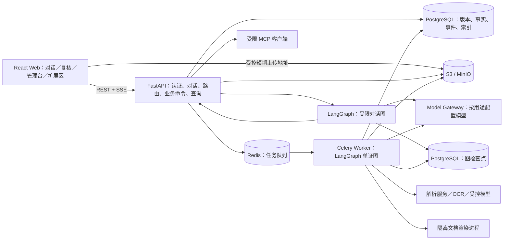
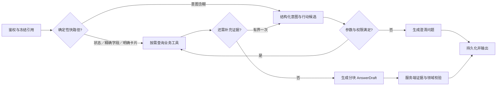
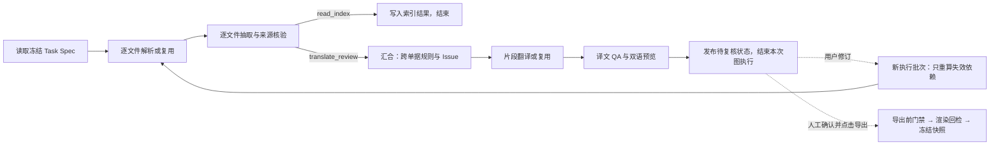

# 物流单证智能体：工程技术方案

2026-10-08 导出契约：交付物是当前确认版本的纯目标语言译本（所选 DOCX/PDF），可选各原件的识别稿 PDF；不生成复核报告。识别稿从冻结 ParseArtifact 的原文与布局生成，不冒充 MinerU 供应商原始 PDF。一个 Run 对应一个目标语言；其他语言使用各自 Run/确认/快照独立导出，当前不提供多语言一键批量翻译或导出。旧成功快照含报告只作接口兼容，不再展示报告下载；旧失败报告清单在原 Attempt 安全重试时升级为译本与识别稿，历史失败事件保留。

版本：v1.2｜2026 年 9 月 28 日｜状态：工程基线已实施；代表业务闭环已验，未验门槛见逐条核验记录

依据：[产品形态与需求规格](../需求设计/物流单证智能识别与转换智能体_产品形态与需求规格.md)及其四篇核心产品设计；具体页面控件与联动以[前端页面总规范](../开发记录/前端/前端页面总规范与联动契约.md)及五份页面设计为实施细则。本文确定实现边界和工程契约；尚未通过真实样本验证的识别效果、模型质量、费用与吞吐量明确列为接入验收项。

## 1. 结论与工程边界

首版采用**模块化单体 API＋LangGraph 编排＋独立后台任务进程**。对话图处理自然语言、澄清和受控工具调用；路由器把明确的意图与参数转换为已注册工作流的不可变 Task Spec；后台单证图编排解析、抽取、校验、翻译和预览。人工复核与正式导出由业务命令衔接。LangGraph 检查点记录图执行位置，PostgreSQL 领域表保存业务真值、版本、审核结论和事件，文件存储保存原件与产物。前端只消费 API 和事件，不直接调用模型、OCR 或文件存储的管理接口。

| 领域 | 首版确定选型 | 决定理由与边界 |
| --- | --- | --- |
| Web 客户端 | React＋TypeScript＋Vite；React Router、TanStack Query、Zustand、Lexical；PDF.js、Radix UI／Tailwind CSS | 桌面优先的对话与三栏复核；服务端状态由 Query 管理，面板和输入草稿才进入 Zustand；Lexical 自定义 `/ `、`@ `结构化标签。具体依赖小版本由锁文件固定。 |
| API 与领域服务 | Python 3.12、FastAPI、Pydantic v2、SQLAlchemy 2、Alembic | 一个代码库内分模块，REST 承担命令与查询，SSE 承担消息和进度流。OpenAPI 生成 TypeScript 请求类型。 |
| 编排 | LangGraph：对话图、共享单证子图及版本化业务图；PostgreSQL 持久检查点 | 图表达条件分支、受限工具调用和可恢复执行；节点只保留小状态与业务 ID，不把整份原文、密钥或业务真值塞进检查点。 |
| 后台执行 | Celery＋Redis；PostgreSQL 中的 Run 状态、步骤账本和恢复扫描器 | 队列只负责投递；Celery Worker 驱动单证图，领域表才是任务状态源。Worker 用独立的同步 SQLAlchemy Session、同步 Postgres checkpointer 和有界 HTTP 客户端，在子进程启动后初始化连接，不跨 fork 共享 API 的 AsyncSession／连接池或 event loop。重复投递和节点重执行必须幂等。 |
| 业务数据库 | PostgreSQL 16；B-tree、`pg_trgm` 与必要的 JSONB | 一开始就建立用户／租户和版本约束，减少从 SQLite 迁移所造成的数据契约变化。搜索先用结构化条件与有界文本匹配。 |
| 文件存储 | S3 兼容对象接口；本地演示当前使用 LocalStack S3；生产使用经验证的 S3 兼容服务 | 原件、解析响应、预览和正式导出分桶／前缀与生命周期；数据库只存对象 ID、哈希和版本元数据。 |
| 模型接入 | 服务端统一 Model Gateway；对话、视觉复读、抽取和翻译的接口地址、API Key、模型名分别从 `.env` 读取 | 首版不从阿里百炼调用模型；使用用户提供的非百炼模型接口与 Key，不在代码中写密钥。不兼容的服务通过适配器接入，不能假设任意模型都支持工具调用、结构化输出或视觉输入。 |
| 文档解析 | 原生 PDF 文本层用 `pdfplumber`，页渲染用 `pypdfium2`；DOCX 用 `python-docx` 与受控解包；扫描页／图片主解析适配 MinerU 精准接口 | 先按页和区域判断是否需要 OCR。MinerU 是首接服务，必须验证实际结构、表格、坐标、限额和失败语义；接入不通过时更换适配器，不改领域数据契约。 |
| 导出 | 版本化目标语言 DOCX 模板＋受控文档生成器；隔离的 LibreOffice 转 PDF 与回检进程 | 输出为可编辑目标语言译本及 PDF，不承诺还原任意原版式。模板、字体和转换镜像随发布固定。 |
| 部署 | Docker Compose 统一启动 Web、API、Worker、调度器、PostgreSQL、Redis、S3兼容服务（当前本地为LocalStack） | 比赛演示先用单机部署；将来可把相同镜像迁移到托管数据库与对象存储。 |

首版就引入 LangGraph，但只建立**一个受限对话图、一个可复用单证处理子图和两个注册工作流**，不拆成多个自主推理 Agent。暂不引入 Temporal、微服务、向量数据库或用户可执行插件。LangGraph 增加编排、检查点与条件分支能力，但不会替代任务队列、业务版本、幂等、权限和审计。

## 2. 部署形态与模块责任



API 与 Worker 共享同一 Python 领域包，但运行在不同进程。API 调用对话图且不等待整票解析完成；Worker 驱动后台单证图且不直接写聊天回复。两类图使用持久化检查点，业务事实和可见进度仍从领域表读取。模型网关和解析适配层只接收本次授权的最小输入，并记录模型／提示词／参数／服务版本。Redis 故障不会擦掉 Run；恢复扫描器依据数据库中超时的步骤租约重新投递可安全继续的图执行。首版先按实测的文件数、页数和单次执行时限限制 Run；一个 Celery 消息只驱动有界图执行，文件完成即提交领域账本与事件，图检查点仍只在 super-step 边界形成。人工等待、异步供应商等待或明确阶段边界结束当前消息，后续投递凭固定 Task Spec、步骤账本和有效检查点恢复，不假设节点内部自动暂停。若目标样本超出该执行上限，发布前增加显式按文件／阶段拆分与聚合栅栏；`acks_late`、Redis visibility timeout 与任务时限按实际执行上限配置，重复投递由领域租约和输入指纹挡住。单票删除由独立受限清理队列处理，Case 先撤权，迟到 Worker 不得复活它。

建议目录保持现有项目结构：

```text
src/
  backend/
    app/api/             # HTTP、SSE、鉴权与请求验证
    app/conversation/    # 对话图、上下文装配、受控工具和记忆
    app/router/          # 工作流注册、意图与 Task Spec
    app/workflows/       # 共享子图、版本化业务图与步骤服务
    app/documents/       # 解析、锚点、抽取、规则、翻译、导出
    app/review/          # 修订、疑点、门禁与快照
    app/search/          # 摘要、检索投影与 @ 选择
    app/extensions/      # Skill、MCP 连接与调用审计
    app/retention/       # 单票 30 天期限、删除命令与幂等清理
    app/infra/           # 数据库、图检查点、对象存储、队列、模型适配
    alembic/
  frontend/
    src/pages/ src/features/ src/components/ src/api/
tests/                   # 按领域与契约组织，不按工具堆放
docs/                    # 需求、方案、开发记录与评测
```

Python 使用项目独立 `uv` 环境和锁文件，Node 使用锁文件与固定运行时；终端仍保持 Conda 优先，不修改全局 PATH 或 VS Code Git。实施时锁定 `langgraph`、`langgraph-checkpoint-postgres`、`pydantic-settings` 和 HTTP 模型适配层所需依赖的小版本；不为使用 LangGraph 而再套一个自由 Agent 执行器。方案阶段不安装依赖。配置统一由 `.env` 加载，提交带逐项中文注释的 `.env.example`，真实 `.env`、凭证和本地代理配置不得入库。

## 3. 对话 Agent：受限 LangGraph，不持有单证事实

### 3.1 图状态、节点与分支

对话不是单次 Prompt，也不是放任模型自主循环。FastAPI 为每条用户消息建立带幂等键的 `ConversationTurn`，冻结本轮图版本、系统提示词版本、非秘密模型配置版本和引用版本，再以稳定、不含明文身份的 `conversation_thread_id` 调用持久化 LangGraph。`ConversationTurn` 记录 `pending/running/completed/interrupted/failed`、租约令牌与期限、最后心跳和最终消息 ID；同一会话同时只运行一轮，重复提交返回同一回合，不同请求在前一回合终态前返回可重试冲突，首版不设隐式排队。图状态仅含 `conversation_id、turn_id、active_case_id、reference_snapshot_id、intent_candidate_id、tool_result_ids、evidence_ids、draft_id、decision、error_class` 等小字段；意图候选和草稿存于有租户权限与过期时间的服务端暂存记录，每轮入口清空上一轮临时 ID。原件正文、模型密钥和大段聊天不进入图检查点。节点每次从服务端身份和领域表重新取授权数据，不能信任历史检查点里的权限。升级图或提示词时，进行中的旧轮次按冻结版本完成或显式中止，不能在恢复中途切换。



| 节点 | 职责 | 模型与失败处理 |
| --- | --- | --- |
| `scope_and_freeze` | 从认证会话取得 `tenant_id/user_id`；校验会话状态、单票绑定、结构化 `/ `与`@ `标签，并冻结本轮原件、解析、业务、译文或 Export Snapshot 版本。用户输入的字符串不能伪造标签 ID。 | 无模型；权限失败直接拒绝。 |
| `fast_path` | 对主卡片、明确 `/ `命令、任务状态、精确字段和结束服务走确定性分支；领域按宽松业务关联判断，不设置学科黑名单。 | 明确业务动作无需额外模型分类；来源标签本身不证明意图，不确定时进入受限意图节点，不能直接启动收费识别。 |
| `intent_and_plan` | 只在自然语言含糊或查询需要多步时，让对话模型返回符合 schema 的 `IntentCandidate` 与受限工具计划；可要求澄清。 | 模型结果只是候选；无效结构最多修复一次，然后安全失败。 |
| `execute_tools` | 在本轮授权白名单内执行查询或服务端签发的任务命令；只读查询可以并行，写命令逐项重新鉴权、校验版本和幂等。 | 初始预算为最多两轮计划、四次逻辑工具调用，由 `.env` 上限控制；超限向用户说明需缩小范围。 |
| `compose_answer` | 精确值和状态优先由服务端模板表达；复杂解释让模型生成按段组织的 `AnswerDraft`，每条本票事实绑定 `evidence_ids`。 | 对话模型不读取完整附件，也不决定 OCR、金额或审核结果。 |
| `verify_and_emit` | 校验证据归属、版本、值和输出边界；将已保存的生成草稿替换为正式答复，来源卡与最终消息原子提交。 | 允许经协议筛选的正文增量先以待核验草稿展示；关键值仍绑定证据，未通过检查的草稿不能成为正式单票结论。 |

上下文装配器加载版本化系统策略、该用户确认过的长期偏好、本轮请求、当前 Task Spec、最多 20 轮本会话消息和同会话摘要。关联 Case 时按问题检索必要字段、Issue、RunEvent 与短原文片段；新会话不加载旧聊天摘要。领域采用宽松业务关联，理解当前材料所需的补充知识可回答；明确无关的独立请求简短引导，其正文不进入后续业务摘要。模糊追问结合安全语境，不用关键词缺失代替语义判断。原件、用户 Skill、MCP 返回仍是低信任资料。模型超时或拒答不影响已有 Run；前端可直接读真实状态。

### 3.2 工具权限、记忆与回答流

首版工具分为只读 `query_case_facts`、`query_provenance`、`list_issues`、`get_run_timeline`、`search_authorized_cases`，以及受控命令 `create_case`、`prepare_task`、`start_run`、`open_review`。申请重识别、字段修订、疑点裁定和正式导出需走对应带版本前置条件的业务接口和页面确认清单；模型不能通过编造工具返回跳过门禁。

系统提示词由项目维护、带发布版本。对话、意图、摘要、抽取、局部视觉复读、翻译与可选 QA 的模板统一进入代码仓内不可变的 Prompt Registry；注册项声明用途、输入变量、输出 schema、信任级别与版本／内容哈希，ConversationTurn 或 ExecutionEpoch 冻结实际版本，用户 Skill 说明和 MCP 返回只能作为低信任资料，不能覆盖系统模板。用户记忆独立保存为经用户确认的偏好，不存客户字段或旧会话原文。本会话摘要只压缩该会话的旧轮次；Case、Run、文件与快照记忆其实是数据库中的版本化业务视图，不是向量库里的一段聊天文本。直接装配的本会话轮次不超过最近 20 轮，超过即压缩更早轮次；若未达 20 轮但 token 超预算，先去重和缩小低相关来源，再增量压缩较旧的本会话轮次，绝不截断本轮任务参数及字段与来源的对应关系。

目标调整为 OpenAI 兼容 `stream=true` 的真实正文增量消费，新增独立的预览开始、正文增量、预览重置事件；现有 `message_delta` 保留已校验段落语义，`message_final` 仍表示已落库正式答复。预览不是正式消息、业务事实或后续记忆。生成时逐块保存并推送模型实际返回的可见正文，过滤协议包装、推理内容和未绑定占位符，标记待核验；完成检查后用 `message_final` 替换预览。工具状态和 RunEvent 独立推送。模型传输超时、断流或上游暂时不可用时，默认最多3次实际请求（含输出修复），退避2秒、4秒；重试前清除旧预览与增量解析状态，只采纳本次完整答复。耗尽后保留中断状态与重试入口，不将半截答复写入记忆。每次外发重新鉴权并留独立调用和未知费用记录；页面重连仅按事件序号重放，不重复调用模型。供应商不支持流式时明确降级为等待完整结果，不用打字动画模拟供应商流。详细协议及验收以[最终补全修复方案](../开发记录/后端/最终补全修复方案_对话记忆与验收.md)的“宽松领域关联与增量答复”为准；真实流式接入已完成，模型中断有限重试于2026-10-16启用。

上传后只问尚未解析的原件内容时，当前 ConversationTurn 可先以“识别中”的真实最终消息结束并释放同会话单轮锁；创建或复用 `read_index@1` Run 时，`AssistantContinuation`、首轮说明消息／事件与 Turn 完成必须同事务登记，并与 Run 状态转移按同一 Run 行锁排序。到 `indexed` 后由 Outbox 唤醒已登记待答项，用原问题和冻结的原件版本在重新鉴权后生成来源答复；`failed_retryable/paused_reconcile` 分别显示待安全重试／待核查并保留同 Run 恢复后的自动续答资格，`failed_final/cancelled` 才以无事实通知终结。续答挂在原 `parent_turn_id` 下，不计第二个用户轮次；会话已结束或权限撤销时不追加原文事实。续答使用独立 `continuation:{id}` 图线程和租约或等价的只读答复服务，只读原问题与冻结引用，不和期间新回合并发写同一个会话图检查点。对话已校验文本块、工具状态和续答结果以原轮持久事件序号回补，RunEvent 仍是单独的业务进度流，具体 URL 和状态见[前后端接口与状态契约](前后端接口与状态契约.md)。

### 3.3 速度与准确性的共同约束

鉴权、`@ `引用元数据和活动 Run 摘要可并行读取；确定性快路径不调用模型。查询先取字段和来源 ID，必要时才取短原文；不要每轮做 OCR、全票 RAG、全文摘要或全部工具发现。LangGraph 每个图步的状态序列化与检查点写入有开销，对话图只保留必要节点和小状态，不能为了展示“智能”把一个简单字段问答拆成十几次图跳转。对话输入、模型输出、工具响应大小和总耗时都设上限，并按角色独立限制并发；不能靠无限增加上下文换准确率。数值比较由 `Decimal` 与规则函数执行，模型只解释结果；字段不确定或来源冲突时优先显露疑点，不强行合并答案。

首版性能数字先作为**目标假设**：不含文件上传时间，任务受理与首个真实状态事件的 p95 目标为 1 秒内；本地可判定的状态／精确字段问答 p95 目标为 1.5 秒内。阶段 0 须先固定部署硬件、冷／热启动、同时对话数、后台 Run 数、每票文件规模和至少 100 次代表性请求的测量方法，之后才把这些数字变成可执行验收门槛；模型问答另记录首个已校验文本块、完整答复、token 和费用的 p50／p95。外部模型超时不能用虚构文字凑“秒回”；页面应先显示已持久化的工具／任务事件，再给有证据的答复。模型选定前不承诺固定的模型问答时延。

## 4. 工作流路由与未来新增流程

### 4.1 路由规则

主卡片直接指定内置 `translate_review`；上传后只问文件内容时指定 `read_index`；显式 `/ `能力标签先核对注册表与权限；自然语言意图含糊时才让对话模型返回受限的 `IntentCandidate`。候选只包含 `workflow_type`、参数、缺失条件、证据句和置信标记，不直接创建 Run。后端根据注册定义重新验证文件、同票归属、目标语言、范围、输出格式、访问权及不支持能力。多个候选或必需参数缺失时返回澄清问题；条件明确后生成可见任务摘要与 Task Spec。已明确的要求不再形式化重复确认。路由 Skill 只调用 `prepare_task` 和 `start_run`，不会把工作流节点逐一交给外层对话模型执行。

`start_run` 接收服务端签发的草稿任务 ID、`expected_draft_version` 和幂等键，不接收模型临时编写的工作流步骤。同一草稿由数据库唯一约束保证至多一个 Run；另一键并发启动返回有权的原 Run ID 与 `TASK_DRAFT_ALREADY_STARTED`。Run 创建后 Task Spec 不可更改：改变参与文件版本、目标语言或翻译范围创建新 Run；安全重试、字段修订后的局部重算仍留在原 Run 的版本链中。只读识别 Run 不需要目标语言，也不会生成译文或 Export Snapshot。

### 4.2 可注册工作流契约

每一种正式工作流都要提供下列实现，先由项目代码注册并发布版本。用户自建 Skill 只能选择已注册动作和参数，不能上传代码变成工作流。

| 契约 | 必需内容 | 目的 |
| --- | --- | --- |
| `WorkflowDefinition` | 不可变 `type/version`、名称、支持的输入 MIME、输出类型、可见阶段、权限、费用级别、`ui_contract` 和图版本 | 路由选择、后端执行与前端展示同一能力边界。`ui_contract` 描述任务表单、阶段标签、结果动作；专属复核界面仍须由对应前端模块实现。 |
| `TaskSpecSchema` | Pydantic 参数模型、必填与默认值、跨字段校验；所有文件均为固定 `document_id + document_version` | 不同工作流可有不同参数，但启动规则一致。 |
| `prepare()` | 不收费的确定性校验与澄清候选，持久化可编辑 TaskDraft 并返回类型化参数与任务摘要；不得启动 Run | 不明确任务不会偷偷启动，刷新后可恢复表单。 |
| `build_graph()` | 编译固定节点、条件边和可复用子图；图状态 schema 及节点版本随定义锁定 | Worker 只能执行注册图，不能由模型临时画步骤。 |
| `step_services` | 用 `step_key + input_fingerprint` 幂等地生成版本化产物和 RunEvent；声明外部调用与重试分类 | 图节点只负责调用受控领域服务，支持失败恢复与局部重算。 |
| `review_policy()` | 哪些 Issue 阻断、哪些操作需要人工、确认条件 | 不把新工作流的门禁写死在聊天里。 |
| `artifact_policy()` | 预览／正式产物、回检和快照要求 | 避免非翻译流程冒用“已导出”语义。 |

注册表首版含 `read_index@1` 和 `translate_review@1`；将来可增加 `template_generate@1`、`document_compare@1` 或指定标准的 EDI 流程，各自有 Task Spec、图、权限、输出和验收样本。前端从注册表读取通用入口、任务表单、阶段与结果动作；需要专属对照或修订交互的流程须同时交付对应页面组件，注册一个后端图不会自动生成完整复核界面。共用文件接收、解析、字段与证据服务，通过输入指纹复用有效产物；新流程不得直接改写其他流程的 Run、原始字段或历史快照。Celery 消息只含 Run ID 与执行批次 ID，Worker 从数据库读取固定 `workflow_type/version` 后在本机注册表取得已编译图；发布新版本时先部署能读取旧数据且同时注册旧、新定义的 Worker，再允许新 Run。旧版本停止接新任务后，至少保留到其活动 Run 全部结束；无法继续执行的 Run 明确暂停并经版本化迁移记录或人工终止，不静默改用新节点。历史数据的读取和下载不依赖旧执行代码一直在线。

Task Spec 采用判别联合模型：公共字段为 `case_id、workflow_type、workflow_version、source_versions[]、initiated_by、created_at、idempotency_key`；翻译流程另含 `target_language、translation_scope、selected_section_refs[]、output_formats、glossary_version、rule_pack_version`，只读识别流程另含 `index_scope`。翻译范围可为全部、货描或已解析区段；选择已解析区段时，每项必须冻结 `document_id/version + parse_artifact_id + logical_document_id + section_id`，W03 在锁定草稿时重新比较当前有效解析版，失效返回 `TASK_DRAFT_PARSE_STALE` 并要求重选，首 Epoch 与 Task Spec 使用同一基线。若原件尚未解析则先完成只读识别或请用户明确可结构化的范围。`source_versions` 已固定本 Run 参与的文件，指定部分文件不靠另一个隐含筛选。输出格式至少一种且不可重复。启动时把**业务输入与工作流规则配置**快照序列化并算哈希，Run 后不可更新；模型服务绑定另按 `ExecutionEpoch` 冻结，密钥不进入 Task Spec。注册新流程必须给出 JSON Schema／Pydantic 模型、旧版本读取策略、前端通用入口配置和至少一个正常、异常验收样本。

### 4.3 新增工作流的实际改动范围

例如增加 `document_compare@1`：先写比对范围、输出 Issue 类型、权限和验收样本；新增 `CompareTaskSpec` 与注册定义；用既有解析／证据子图读取两份冻结原件，再加入确定性字段对齐、差异核验和人工复核节点；新增对应 Issue 卡片或对照视图；最后补 OpenAPI、旧版本读取与局部回归。对话图只需通过注册表发现这个新能力，通用上传、路由、事件和权限代码不必复制。LangGraph 减少条件分支、检查点与节点复用的手写代码，但不会自动产生比对规则、提示词、前端页面或可核验样本。

## 5. 单证工作流与模型调用位置

### 5.1 固定主线

`Upload Session → 文件类型与质量检查 → 解析／OCR → 逻辑单据与区段 → 字段／行抽取 → 规则与疑点 → 受控翻译与 QA → 双语预览 → 人工复核 → 整组导出回检 → Export Snapshot`。

上传前端取得短期上传凭证，逐文件传到受控对象存储；API 收尾时核对大小、哈希、文件魔数、压缩展开上限和归票，成功才创建不可覆盖 DocumentVersion。文档解析在限制资源且禁用宏／外部链接的进程中进行。类型识别与预处理只生成候选边界；有效解析产物才创建 `parse_artifact_id` 及其 LogicalDocument／DocumentSection。原生 PDF 和 DOCX 优先抽取文字与表格；即使存在文字层，只要阅读顺序、表格或关键区域覆盖不足，也回退到 MinerU。图片、扫描页与 DOCX 嵌图按区域走 MinerU；混合文件逐页判断。DOCX 同时检查正文、表格、页眉页脚和嵌入媒体，无法稳定抽取的文本框或绘图区域列为未覆盖，不能静默丢失。解析器需统一产出块、表格、行、阅读顺序、来源锚点、坐标变换与 Markdown 阅读副本，缺少定位能力必须显式记为 `page_only`／`paragraph_only`，不能猜矩形框。当前翻译目标语言与界面语言统一使用 `zh-CN / en / fr / es / ru`（简体中文、英语、法语、西班牙语、俄语）。五语互译沿用同一翻译图，源语不明确时要求确认；界面语言独立于任务目标语，不改变冻结任务与历史译本。

| 处理点 | 是否调用模型 | 输出与自动化边界 |
| --- | --- | --- |
| 对话意图、任务澄清和自然语言回答 | 对话模型 | 只返回候选意图／文字；路由和事实由服务端核验。 |
| 文件类别与页面质量 | 先用文件元数据、文字层、版面规则；歧义时可用视觉模型 | 产生类型候选和质量 Issue；重要归票与不清晰边界交用户确认。 |
| 原生文字层、DOCX 与标准数字解析 | 不调用大模型 | 保留页／段／表来源，Decimal 和编码由确定性代码处理。 |
| 扫描／图片解析 | MinerU 解析服务；局部模糊区域才用视觉模型二次识别 | 保留两份候选及区域来源；模型一致不等于事实正确。 |
| 字段、主体角色、行项目抽取 | 稳定版式先用规则；复杂语义用结构化输出模型 | Pydantic 校验字段 schema、角色、单位与锚点；无法回指源片段的值只作为待复核候选。 |
| 单据内算术、跨单据规则、有限规则包 | 不由模型作最终判定 | Decimal、角色语义、规则版本和适用条件决定 Issue；模型可建议行匹配候选，程序与人工验证。 |
| 译文与源译对齐 | 翻译模型按逻辑单据／片段批量调用 | 保护编号、金额、日期、单位和占位符；返回片段 ID 对应关系，不能改原值。 |
| 翻译 QA | 确定性检查为门禁；可选模型作语义疑点候选 | 漏译、数字变化、术语、空译和源译片段覆盖可追踪；模型不能单独判“合格”。 |
| 摘要与检索 | 结构化字段和事件生成；可选模型润色非事实语序 | 保存来源 ID、范围与版本；摘要不能作为回答证据。 |
| 模板排版、识别稿和导出回检 | 不由模型自由生成业务值 | 从冻结业务／译文版本填入模板；检查产物文本、字段和版面。 |

同一原件重解析产生新 `parse_artifact_id`，替换上传才产生新 `document_version`。首次结构化字段抽取形成基线业务 `revision_id`，候选仍标待复核。字段或人工事实修订新增 Case 业务版本，纯译文修订只新增所属 Run／语言的 `translation_revision_id`。译文版本是该 Run／语言全部片段的不可变视图，局部编辑采用复用未变片段的新版本；它记录创建时所依据的业务版本、各文件解析版本及实际读取的字段／片段依赖。历史来源与导出快照固定其原件／解析／业务／译文配对，不能引用当前值填补旧视图。

有限规则包放在版本化项目配置中，记录规则 ID、适用国家／线路／货物条件、来源链接或文件、有效期、审核人及生效版本；确定性规则函数只读取明确字段。规则前提不齐或样本未覆盖时输出“不适用／未覆盖／无法判断”，不以联网模型生成实时法规作为判定。升级规则包不回写历史 Issue，新 Run 使用新版本；旧 Run 若要按新规则处理，需创建明确的重评任务及审计记录。

首版的原件识别、字段抽取、双语翻译和通用跨单据一致性检查不把贸易线路或货类写死在流程里，可处理发票、箱单、提单与其他佐证材料的多种货物描述。线路／货类特定的 HS、证书和法规提示另走适用性明确的有限规则包：先以中国出口至欧盟的一般非危险消费品材料作规则包验收样本，具体权威来源、有效期和审核人核实前不启用法律结论；其他线路或货类仍可使用通用处理，但专项规则显示“未覆盖／无法判断”，不冒充全面合规审核。

### 5.2 单证图、人工等待与局部重算

`read_index@1` 和 `translate_review@1` 共用 `document_ingest` 子图，依次做文件类型／质量检查、解析、逻辑单据与区段分类、字段抽取、来源核验，然后分支：只读流程写索引并结束，不执行正式跨单据校验、翻译或人工裁定；翻译流程才进入规则、翻译和预览。节点是**有限、显式、版本化**的业务步骤，不采用“模型观察结果后自主决定下一节点”的自由推理。单个原件的解析和抽取可按文件有界并行；翻译流程的跨单据规则必须在参与文件的结果汇合后运行。扫描页的页内并发由解析适配器控制，不把每一页变成一个长期图节点。

解析后若逻辑单据边界／类型、混排源语言或“只翻货描”的实际源段范围无法可靠确定且影响任务继续，图写入持久 `InputRequest` 后正常退出，Run 进入 `awaiting_input`；用户经带预期版本的业务命令回答后，在同一 Run 新建 ExecutionEpoch 继续，不维持跨天 `interrupt()`。`InputRequest.kind` 首版为 `document_boundary/source_language/translation_scope`：分别确认类型与区段归属、冻结范围内的语言分布、`goods_description` 选择器零命中或多候选时的货描源段。Task Spec 冻结选择器版本，解析后另建不可变 `ResolvedTranslationScope`；活动请求必须经同一个 resolve 命令回答，普通区段修订不能绕过。若要改变参与文件或翻译范围的语义，创建新 Run。



`RunGraphState` 仅包含 `run_id、workflow_version、execution_epoch、task_spec_hash、artifact_ids、branch_decision、error_class`，原始响应、Markdown、字段值、译文和 Issue 均由领域服务按 ID 读写。Celery 投递 `run_id + execution_epoch`；Worker 取得 Run 租约后用稳定的内部 `thread_id = run:{run_uuid}:epoch:{n}` 驱动相应图。执行批次在同一 Run 内递增，表示原输入处理、人工修订后的重算或导出阶段；它不是新的业务任务。每个批次冻结非秘密 `ModelBinding`（角色、端点 URL、模型名、协议、超时、输出和并发上限、温度、适配器版本与配置哈希），具体 Key 从运行进程 `.env` 获取；调用模型时必须按该批次绑定核对非秘密配置。若旧批次所需端点或 Key 已不可用，则暂停并显式迁移或终止，不静默改用新模型；旧批次结果保持原绑定。发布 `awaiting_review` 后图正常结束，Worker 释放资源，长时间人工等待由 Run 状态和 Issue 清单承接；首版不把审核页保持为一个跨天 `interrupt()`，避免用户编辑字段后恢复到旧检查点并重放副作用。人工修订在领域事务中写新版本、计算失效依赖并创建下一执行批次；新图从当前领域版本读取数据，匹配指纹的有效产物直接复用。人工确认本身不改变 Task Spec；正式导出必须由显式业务命令启动导出阶段，再检查当前版本门禁，不能仅靠图的旧分支判断放行。

LangGraph 的检查点用于节点级恢复和诊断，不用于回滚已付费的模型调用、撤销数据库写入或覆盖已导出的快照。若将来某个短时子流程确实使用 `interrupt()`，须以同一 `thread_id` 和 `Command(resume=...)` 恢复；恢复前重新鉴权和校验业务版本，并保证中断所在节点从头执行时不会重复外部副作用。共享子图的状态 schema、并行归并规则和节点输入输出要有版本，禁止两个并行分支无规则覆盖同一个字段。

| 异常情形 | 图分支与业务结果 | 用户可见反馈 |
| --- | --- | --- |
| 页面模糊、OCR 无可靠锚点 | 保留原件和低精度来源，产生识别 Issue；可做受控局部复读，仍无法判定则待人工修订 | 显示不确定区域与来源精度，不把猜测写成确认字段。 |
| 跨单据字段冲突或缺少规则前提 | 规则节点产生红／黄 Issue 或“无法判断”；译文预览可形成草稿，仅当前未解决红项阻断，黄项及其他疑点不阻断 | 侧栏定位全部冲突来源并列出所需补充资料。 |
| 模型超时、限流或结构化结果无效 | 在 StepExecution 记错误类；只对安全瞬态错误按预算重试，结构无效可有限修复后暂停 | 显示当前阶段及失败原因，不显示虚构的完成百分比。 |
| 用户在处理过程中修改字段或权限被撤销 | 迟到结果只归属旧输入版本；当前指针不回退；按新依赖开执行批次或终止访问 | 卡片提示版本变化，重新打开时按当前权限和版本呈现。 |
| 导出渲染或回检失败 | 暂存产物不可见，`ExportSnapshot` 不登记；可安全重试或人工排查 | 管理台只保留过去成功快照，本次显示明确失败。 |

### 5.3 依赖失效和审核门禁

每个派生产物记录来源版本与 `input_fingerprint`。指纹覆盖它**实际读取**的原件／解析版本、字段或片段 ID 与值、步骤代码版本、解析适配器和服务协议版本、实际模型 ID／参数、规则／术语／模板／提示词版本，不把整个 Case 的 `revision_id` 当成所有产物共同失效键。另存 `ArtifactDependency` 关系，用于找出受影响的 Run、文件、规则、译段、预览、摘要与索引。新任务默认只复用指纹和有效性策略都匹配的产物；更换默认服务或模型不会篡改既有产物，但新的兼容性决定必须有记录。

字段修订、事实裁定、纯译文修订或采用新的 `parse_artifact_id` 时，在同一数据库事务内写不可变版本／处置记录、更新当前指针、标记相关 QA、预览、摘要、检索投影与**当前工作版的导出资格**为 `stale`，并写 RunEvent；事务提交后才投递受影响步骤。纯译文修订不重算 OCR、业务算术或其他语言；采用新解析结果时即使识别文字相同，也因来源关系改变而新增业务版本，旧区段、行和匹配需映射或待复核。对 `selected_sections` Run，若新旧选区没有可核验证据映射，发 `document_boundary` InputRequest，未确认前不重译；需扩大或缩小冻结范围时建新 Run。只接受黄项而不改字段时追加 IssueDisposition 并重评门禁；改变人工采用值才产生业务版本。首版可以重算同 Run 的规则集合，但不重复 OCR 未变化原件；逐页／逐行重识别是后续优化。旧快照与旧版本保留只读。迟到的模型返回只能写入它声明的旧输入版本，不能覆盖当前指针。

业务 `revision_id` 增加时，译文版若所依赖字段、原文片段、解析版本与术语均未变化，且既有 QA 仍适用，可与新业务版建立一条可审计的 `TranslationCompatibility` 有效配对记录，不必为了无关字段重译或制造新译文版；若任一依赖变化，则先标过期，局部重译及 QA 完成后新增该 Run／语言的译文版。导出快照同时冻结当前业务版、实际使用的译文版、解析版本和配对依据。兼容性由依赖指纹与程序检查决定，模型不得口头宣称兼容。

Issue 至少分为识别错误、原件冲突、资料缺失、翻译问题、规则不适用／未覆盖及运行故障；保留原始规则结论、人工处置与是否阻断交付三个不同字段。只有当前未解决红项阻断确认稿；已忽略、有依据裁定、不适用或完成修订的疑点退出待办，原始规则与处置仍留档。黄项及其他疑点不阻断；主动处置仍记录操作者和理由。候选字段不要求逐项确认才能导出，审核记录如实标注其候选／人工确认状态。每份参与物理源文件必须有有效、可定位的双语 `reading_html` 才进入可确认状态；带水印 `draft_pdf` 为可选草稿下载，生成失败只禁此动作。R13 计算 Run 范围的 `review_fingerprint`，包含原件／解析／业务／译文配对、字段审核、RuleCheck、Issue 处置、行匹配、QA、有效 HTML 预览和输出格式。用户点击“复核完成”时，R14 在事务内重算指纹与门禁并创建不可变 `ReviewConfirmation`：冻结上述依赖、确认人和时间；同 Run 同指纹已有有效确认则返回原记录，不因换幂等键生成第二张。任何相关修订或重解析都会使当前确认失效，历史确认仍只读。正式导出 R15 必带 `confirmation_id` 与 `expected_review_fingerprint`；启动渲染前与登记 Export Snapshot 前均重算比较，按 `run_id + review_fingerprint` 拦截未结清失败 Attempt，不允许换确认 ID／幂等键绕过。任何一个必需文件或所选识别稿 PDF 回检失败，本次都不形成成功快照；已有成功快照仍以历史版本可查。

## 6. 任务状态、幂等、恢复与事件

Run 的**当前工作状态**保存在 PostgreSQL，最小路径为 `queued → processing → awaiting_review → ready_to_export → exporting → exported`，处理中遇必须补充的分类／语言确认时走 `processing → awaiting_input → processing`；另允许 `paused_reconcile / failed_retryable / failed_final / cancelled`。`awaiting_input` 尚未形成可复核译本，不能与译后 `awaiting_review` 混用。已导出后发生业务修订，可重新进入 `processing` 或 `awaiting_review`。是否曾成功导出由存在的 Export Snapshot 独立判断，因此“有历史导出、当前版待复核”是合法组合。只读识别 Run 在索引完成后进入 `indexed`，不会被称为“翻译完成”。状态转换由领域服务检查，不接受任意前端传来的新状态。`ExecutionEpoch` 记录同一 Run 的第几次图执行、图版本、输入业务版本、模型绑定和目的（首次处理／修订重算／导出），不是取代 Run 状态的另一套业务状态机。

每一步的 `StepExecution` 记录 `run_id、execution_epoch、workflow_version、graph_node、step_name、step_version、input_fingerprint、attempt、lease_token、lease_until、provider_request_key、external_task_id、status、artifact_id、error_class`。相同业务步骤及输入指纹只允许一个有效结果；Celery 至少一次投递，Worker 先争取数据库租约再驱动图，长步骤续租，提交时以 `lease_token` 和当前执行批次作栅栏检查。旧 Worker 的租约过期不代表可无条件重发收费请求；须先核查外部调用状态。每个节点先通过领域事务提交产物、执行账本和 RunEvent，**事务成功后才返回给 LangGraph 写检查点**；若恰好在两者之间崩溃，重执行节点必须通过指纹和结果 ID 读回既有产物，不能再收费或写第二份事实。收费外部接口调用前先持久化确定性的 `provider_request_key` 与提交中状态；若供应商支持幂等键，则带它提交，若支持按客户端请求键查询，则恢复时先查询。取得 `external_task_id` 后立即保存。模型传输超时、断流和暂时不可用按用户2026-10-16确定的有限重试策略执行：同一逻辑调用默认最多3次实际请求（含输出修复），退避2秒、4秒，单次使用冻结角色超时，整组不超过600秒并受token／费用与Worker预算限制。中断调用记录`interrupted`和未知费用，耗尽后返回`failed_retryable`，复用成功步骤；不声称供应商未受理。OCR未知提交、账本写入失败及进程在外部受理后崩溃仍须凭查询键确认，否则置为`needs_reconcile`并核查。接入验收必须测这个窗口，不能宣称所有外部任务都可无损自动恢复。重试区分瞬时网络故障、限流、永久参数错误和真实业务疑点，后两类不自动重试。

`needs_reconcile` 使 Run 进入 `paused_reconcile`，普通用户在复核区和管理台只看到“外部请求待核查”、发生时间和可公开的处理说明，不收到请求键或步骤 ID。仅有运营核查权限的人员可在管理台 Run 时间线打开 O01 受控抽屉，GET 步骤后带 `expected_step_version`、依据引用、理由和幂等键提交 `reconcile_step`；结论限定为：`已执行且结果可验证`（登记外部任务 ID、回取并校验结果后继续）、`确认未执行`（生成授权重投记录，允许同输入安全重试）、`仍无法确认`（继续暂停）或 `终止本次 Run`。普通用户不能用一句“重试”绕过不确定提交；所有结论、操作者、时间、凭据引用和状态变更进入追加式审计。恢复扫描器只处理核查后已明确允许重投的步骤。

生产使用 PostgreSQL 持久 checkpointer：API 对话图用其锁定版本适配的异步 saver，Celery 单证图用同步 `PostgresSaver`；首次启动执行迁移／`setup()`，内存 saver 只允许本地无持久化试验。图调用明确使用 `sync` 持久化模式；完整检查点位于 super-step 边界，不能把每个节点返回误认为已经写完完整检查点。节点产物先落领域账本，崩溃时仍按账本、pending writes 与检查点共同核对并幂等重放；实施时以故障注入验证具体锁定版本。对话和后台图使用不同命名空间及不可预测的内部 thread ID，并把映射与所属租户记录在领域表；任何恢复或查看图状态的入口先从认证身份验证这层映射。检查点只承担运行恢复，业务审计仍看不可变消息、RunEvent、StepExecution、IssueDisposition、ReviewConfirmation 和 Export Snapshot。活跃图检查点随数据库备份；绑定 Case 的图检查点至多保留到该票 30 天期限，主动删除时随票清理，不能让检查点成为业务追溯或删除策略的例外。

`RunEvent` 与 Upload Session 事件在同一业务事务里写入递增 `seq`，包括阶段、状态、时间、文件／页、可读描述与可靠的分子分母。SSE 使用 `Last-Event-ID` 补齐；前端先取快照再订阅，只按序号去重。无可靠分母时显示阶段文字，不生成百分比。数据库事件是进度真值，LangGraph 的内部流和 Redis 消息都不作为历史来源。启动 Run 或创建新执行批次时，在同一领域事务写待投递 Outbox；发布器投递 `run_id + execution_epoch`。恢复扫描器查未确认 Outbox、租约过期且可安全重试的步骤，核对检查点与步骤账本后继续图执行；检查点丢失但领域产物完整时按固定 Task Spec 和步骤指纹重建执行批次。人工等待、导出确认和 `needs_reconcile` 不会被自动越过。

对话图有独立的超时扫描：API 持有 `ConversationTurn` 租约并续租；发现过期回合时，若最终消息已提交则补记 `completed`，否则原子地记为 `interrupted`、释放会话占用并向页面返回可重试入口。存活回合内的模型传输中断有限重试，重试前清除半截预览。进程崩溃或回合租约实际过期后不自动重放原回合；用户再次发送形成新回合，已执行的写工具以本轮保存的工具调用键与业务幂等结果返回，不能创建第二 Run。原回合保持可审计的中断记录，同一 `Idempotency-Key` 始终返回该原回合结果。

对外命令包含 `Idempotency-Key`；`start_run`、文件上传完成、确认修订、`confirm_review`、`reconcile_step`、`migrate_run_model`、取消和导出分别保存作用域、请求摘要与结果，重复请求返回同一结果，参数不同而键相同返回冲突。修改接口还必须提交当前业务／译文版本作为前置条件，冲突时返回差异而非覆盖。取消 Run 时递增执行栅栏并停止后续节点；已经提交到外部的请求按供应商能力取消或核查，迟到结果可保留为旧批次记录但不能改变当前指针、重新开启 Run 或生成新 Export Snapshot。

## 7. 数据模型、存储与隔离

### 7.1 最小持久化模型

| 对象 | 身份与约束 | 保存的关键内容 |
| --- | --- | --- |
| `Case`、`UploadSession` | `tenant_id + owner_id + case_id`；上传会话独立于 Run | 归票、文件接收、用户与时间。 |
| `SourceDocument`、`DocumentVersion` | 原件版本不可覆盖；哈希只在该用户范围提示重复 | 对象键、MIME、大小、页数、上传者和时间。 |
| `ParseArtifact`、`LogicalDocument`、`DocumentSection`、`SourceSegment` | 解析版本必须属于指定 DocumentVersion；节与锚点属于该解析版本 | 引擎／配置、块表行、位置和阅读副本的对象 ID。 |
| `BusinessRevision`、`FieldAssertion`、`LineItem`、`LineMatch`、`ArtifactDependency` | Case 内业务版本唯一；原值和来源不可覆盖 | 规范值、候选、人工采用值、审核状态、行关联、来源依赖及依据。 |
| `Run`、`RunDocument`、`InputRequest`、`ExecutionEpoch`、`ModelBinding`、`ModelMigration`、`StepExecution`、`StepReconciliation`、`RunEvent`、`QueueOutbox` | Task Spec 冻结参与的 DocumentVersion 集合；同 Run 最多一个活动 InputRequest；执行批次属于 Run 并冻结非秘密模型绑定；事件按 Run 递增 | 类型／版本、运行期待补条件、图版本、输入批次、参数、执行与核查账本、模型迁移、待投递任务、状态与费用标记。 |
| `Issue`、`IssueDisposition`、`ReviewConfirmation` | Issue 引用全部涉及的来源与规则版本；处置与整组复核确认追加记录 | 严重度、阻断状态、依据、冻结清单与版本配对、操作者和时间。 |
| `TranslationRevision`、`TranslationSegment`、`TranslationCompatibility`、`PreviewArtifact` | 译文版本归属 Run／目标语言，声明业务与解析依赖 | 原译片段映射、术语与 QA、跨业务版的有效配对记录、预览版本及过期状态。 |
| `ExportAttempt`、`ExportSnapshot`、`ExportArtifact` | 快照 manifest 仅在整组暂存产物回检成功后原子登记，历史只读 | 逐源文件原件／解析／业务／译文版本、所选格式、文件哈希及所选逐源识别稿 PDF。 |
| `Summary`、`SearchProjection`、`Conversation`、`ConversationTurn`、`TurnEvent`、`AssistantContinuation`、`ReferenceSnapshot`、`UserMemory`、`Extension` | 全部带 tenant／user、作用范围、版本与状态；ConversationTurn 有幂等键和租约，续答关联原回合且不计新用户轮次 | 检索辅助、冻结引用、已验证消息块与最终答复、中断／续答恢复、确认过的偏好、能力与调用审计。 |

原始证据、业务字段和阅读检索三层分开。大文件、OCR 原始响应、Markdown、预览与正式文件进对象存储；PostgreSQL 存受控对象键、哈希、关联和小字段。业务版本采用不可变 Revision 行＋指向不可变字段／行／Issue 选择记录的关联表；新版本复用未变记录，当前指针只在事务成功时更新。导出事务先检查所有暂存产物，再写一次快照 manifest 和对象映射；失败暂存不进入正式列表。对象物理写入与数据库事务无法天然原子化，先写暂存对象并回检、再登记可见快照。清理器在同一并发栅栏下保护运行中／可重试 ExportAttemptItem 的暂存引用；同 Attempt 重试复用已回检项前重新核对对象存在、大小和哈希，缺失项重渲染回检，无引用孤儿才按生命周期回收。

### 7.2 权限与隐私

所有业务表、检索投影、事件和审计行都含 `tenant_id`；租户内再按用户和授权 Case 检查。API 从认证会话派生身份，绝不信任请求体的 `tenant_id`。查询固定执行租户过滤，PostgreSQL RLS 为敏感表提供第二层保护；跨表引用采用包含租户的外键或同等约束。即使首版只有一个演示账号，也不能写“若无登录则用默认用户”的访问路径。

对象键按租户隔离且不可猜测；原件不跨租户去重。上传使用只允许写入临时对象、短期有效的签名地址，上传完成仍须经 API 鉴权和哈希校验才入库；授权撤销后未完成上传无法变成业务原件。敏感原件、历史快照与正式导出统一通过 API 鉴权后的分块代理下载，支持 Range 请求，每次新请求均核对当前权限与版本并设置 `Cache-Control: private, no-store`，不发可绕开撤销检查的对象存储直链。浏览器不持有存储管理凭证。搜索建议、计数、摘要、SSE、侧栏深链、`@ `和缓存键都带身份与版本范围；用户失去授权后，旧页面链接与后续下载请求不能读取正文。服务端日志只留 ID、耗时、错误码与脱敏摘要，不写大段原文、手机号、密钥或模型完整请求。

认证首版采用本地账号、Argon2id 密码哈希和服务端会话，Cookie 设置 HttpOnly／Secure／SameSite，写操作启用 CSRF 防护；生产接入组织身份提供方时替换认证适配层，业务表不改用户主键。每次数据库事务设置当前 `tenant_id` 的事务级 RLS 上下文，连接归还前不得泄漏上下文；RLS 负责租户边界，Case 的用户授权仍由领域查询和写入服务校验。团队共享后加 Case 级角色授权，至少区分查看、发起、修订、裁定和导出确认。模型与 OCR 是外发处理：隐私文档明确说明第三方服务与数据范围，上传不设额外告知确认；后台核对当前政策版本并记录本次所用服务。个人 MCP 凭证由服务端信封加密保存且只以引用 ID 关联；演示环境的加密主密钥从运行环境注入，生产使用托管密钥服务，主密钥与密文分离。个人凭证不能放在普通 `.env`、浏览器、提示词或日志；若安全存储未就绪，禁用需要个人密钥的连接。

## 8. 检索、摘要与是否向量化

首版**不做向量化**。`@ `与管理台先按租户和授权 Case 过滤，再查询文件名／编号、日期、Run、语言、逻辑单据类型、字段角色、处理人、快照版本和短摘要。精确字段走 B-tree，文件名／编号／中文短摘要的模糊搜索使用 `pg_trgm` 与有界候选；类型、来源地和收件人组合默认要求同一 LogicalDocument 命中。原文段落查询先限定选中的 Case／文件／解析版本，再对 SourceSegment 做有界文本查找。数据库结果显示命中的文件、节、角色和版本，避免跨文件拼出一个不存在的单据。

摘要按 Case、原件版本、解析版本内 LogicalDocument、Run × DocumentVersion、Run 和 Export Snapshot 分范围保存。优先由结构化字段、Issue、RunEvent 和快照 manifest 生成；每个摘要保留来源 ID、输入指纹和 `ready/stale/failed`。摘要用于候选排序与导航，单证问答必须再查授权字段和原文。工作版更新时只使受影响摘要与搜索投影过期；历史快照的索引、摘要与文件冻结不重写。

若实际问题集中出现“同义表达／跨语言货描搜不到”，且关键词方案在固定评测集的召回率或人工查找时间不达标，再在同一 PostgreSQL 内增加 `pgvector`，由独立 SearchProvider 接口切换。向量写入必须带租户、Case、原件／解析／业务版本、权限标签和重建状态；检索先过滤授权范围，再做相似度排序，最后回查原文。不能把多个用户的文件放进无权限过滤的共享向量集合。

## 9. 前后端分离与页面联动

Web 是静态部署的 SPA；所有业务判断和状态转换在 API。前端依 OpenAPI 生成的类型调用 REST；实时读取采用 SSE。`/ `与`@ `在 Lexical 中作为可删除节点实现，客户端负责候选体验，服务端负责权限、版本和可调用性。聊天正文、候选标签与文件上传草稿分开保存，不能把标签名称当权限凭据。

2026-10-02实际生成范围：`src/backend/scripts/generate_frontend_contracts.py`从真实FastAPI OpenAPI生成已发布JSON请求、响应schema及引用闭包、path/query参数到`src/frontend/src/api/generated/request-contracts.ts`。前端运行`npm run contracts:generate`重建、`npm run contracts:check`校验漂移，`typecheck`先检查契约再tsc；使用项目`.venv`和已有依赖。W02/W03草稿和启动请求、C01/C04会话及回合发送、R14/R15确认／导出／重试已复用生成类型或`satisfies`；版本缺失先提示刷新。required、nullable、default可选与additionalProperties按OpenAPI，不额外生成通用SDK或保存整份JSON。W01/W02/W03/W04及解决输入、取消、重试共9路由已发布WorkflowView／TaskDraftView／RunView响应模型，前端直接使用这三类生成别名；生成器同时纳入已有身份、政策、上传和证据响应模型。裸dict、无内容或文件响应继续列入未类型化JSON响应清单，其余手写DTO尚待逐项发布，不能宣称所有响应已类型化。

本次响应契约补齐范围（2026-10-02，先固化后实现）：发布工作流列表项 WorkflowView、任务草稿 TaskDraftView、运行详情 RunView 的真实 Pydantic 响应模型，应用到 W01/W02/W03/W04 及返回相同 RunView 的解决输入、取消、重试接口。逐字段核对领域服务当前返回值，保留实际返回的 nullable 值与历史可省略扩展字段；顶层及固定结构拒绝额外字段，动态 JSON Schema 明确允许扩展。生成器仅纳入真正发布的响应 schema 及引用闭包，前端这三个 DTO 直接使用生成别名；其余 dict 响应继续列在未类型化清单，不宣称已完成。验收必须包含真实 PostgreSQL W04 查询、外层事务回滚的 W02 创建，以及 HTTP 响应缺少 required 字段触发 response_validation，不能只测自造 DTO 数据。实施验收：真实W04读取现有Run与DocumentVersion字段全量保留；两类W02创建／读取／修改、W03启动／同键重放和取消通过生产HTTP路由，新增领域数据与队列均由外层事务回滚且6类表残留0。移除真实响应task_spec_hash触发missing，添加未发布扩展触发extra_forbidden；W01规则包法规来源与动态schema逐字段对照相等。响应测试2项与管理／注册表回归合计10项通过；前端typecheck与契约漂移检查通过。工作流类型为注册表发布字符串，草稿参数联合由其parameter_model生成，沿用各注册参数模型的额外字段策略，不另设两类参数白名单。

| 页面 | 前端主要职责 | 后端主接口与同源数据 |
| --- | --- | --- |
| 对话页 | 头像、消息流、上传和主卡片、任务摘要、来源卡、结束服务；保留本会话 UI 草稿 | C01–C09、U01–U06、W01–W06、R01；具体为 `/conversations/{id}/turns`、该轮 `/events`、`/runs/{id}/events`、`/evidence/resolve` 等。 |
| 校验侧栏／全屏 | 原件／译文双向定位、字段与疑点、修订影响预览、审核和导出 | R01–R16、U07–U09；`/cases/{id}/review-view`、`/runs/{id}/review-checklist`、`/previews/{id}/manifest`、`/runs/{id}/exports` 等，写入带版本前置。 |
| 单据管理台 | 一行一 Run、状态与多维检索、展开逐源文件、历史快照、`@ `入口、30 天期限与整票删除 | M01–M06、U03、R16、C08；`/runs`、`/runs/facets`、`/cases/{id}/overview`、`/cases/{id}/delete` 等。 |
| Skill／MCP 仓库与设置 | 列表、编辑、连接测试、工具授权、调用状态和本人偏好 | E01–E10、P01–P04；`/extensions`、`/mcp-connections`、`/extension-calls`、`/me/preferences` 等。 |

精确路径与 DTO 均以[前后端接口与状态契约](前后端接口与状态契约.md)为准，编码前再固化为 OpenAPI。服务端提供统一 `EvidenceTarget`：`case_id + document_id + document_version` 是未解析原件最低入口；已解析原文增加 `parse_artifact_id + logical_document_id + section_id + source_anchor/source_segment_id`；字段／Issue 增加业务 `business_revision_id`，译文增加 `run_id + target_language + translation_revision_id + translation_segment_id + preview_version`，历史导出增加 `export_snapshot_id`。服务端逐层验证归属和版本。前端路由只保存这些受控 ID，返回管理台时保留筛选、展开、滚动和焦点；不把对象存储路径或长期下载地址写进 URL。

PDF／图片预览用 PDF.js 和页图叠加可定位区域；DOCX 原件以经过服务端净化的段落／表格阅读视图定位，必要的版面预览由隔离渲染进程生成并绑定预览版本。译本预览单独渲染。滚动联动按片段映射，手动滚动或新点击可取消旧自动定位；没有可靠坐标时退到可证实的页／段落并说明定位精度。

## 10. Skill 与 MCP 的工程边界

内置路由 Skill 是服务端注册的业务能力描述和参数校验入口。用户自建 Skill 保存版本化 manifest、说明、参数 schema、已注册动作白名单及作用域；说明是低优先级任务资料，不能改变系统提示词或执行脚本。编辑产生新版本，旧调用仍指向旧版本。调用前重新校验扩展、用户、Case、版本和所需动作。

MCP 首版只支持一种经验证的远程 Streamable HTTP 连接模板、真实握手／工具发现／schema 快照，以及至少一个授权只读工具的真实调用。用户“创建 MCP”是创建已有服务的连接与授权记录。端点只允许 HTTPS 和部署批准的主机范围，禁止回环、本地和内网目标；重定向再次检查目标。工具参数由服务端按 schema 与本票作用域校验，远端返回标记为外部资料。连接失效或工具 schema 变化时暂停新调用，旧记录只读。外发本票原文与敏感字段前按界面授权范围和连接权限检查；扩展不能直接写字段或放行导出。

## 11. 配置、可观测性与运行成本

### 11.1 `.env` 配置与模型角色

配置由服务端启动时通过 Pydantic Settings 从项目 `.env` 读取、验证并转为不可变运行配置；不在源码、前端打包变量、工作流定义或 Prompt 中写 API Key、接口地址和模型名。首接协议按用户决定采用 OpenAI 兼容 Chat Completions 薄适配器，结构化输出和视觉输入仍必须按所填实际模型实测；OCR 首接 MinerU。项目提交 `.env.example`，**每一个变量都用中文说明用途、获取方式和是否必填**；真实 `.env` 永不入库。用户提供 Key 后只需填入 `.env` 并重启受影响进程。生产环境如由部署平台注入同名环境变量，也必须遵守同一 schema；同一部署批次的 API 与 Worker 使用同一配置版本。Run 的 Task Spec 只冻结业务输入与规则，首个 `ExecutionEpoch` 冻结角色、实际模型 ID、协议、参数、Prompt 版本及非秘密配置哈希；后续 Epoch 默认继承原 Run 的绑定和 Prompt 版，O02 只在明确受控迁移时更换模型绑定，绝不保存旧 API Key。

只轮换同一模型服务的 Key 时，重启后的安全步骤可用新 Key 继续；若旧凭证下已受理的外部任务无法查询，进入 `needs_reconcile`。更换端点、模型或协议时，已有 Run 不静默改用新配置：具备 `ops_migrate_model` 权限的运营人员先取 O02 的非秘密迁移选项，再于 `awaiting_review/failed_retryable` 等安全非运行阶段带配置指纹、所见 Epoch、理由和幂等键执行 `migrate_run_model`；服务端记录旧／新绑定、操作者、预估重算范围和费用，按输入指纹使受影响产物过期，再创建绑定新模型的新执行批次。Task Spec 哈希、Prompt 版本和旧批次审计不变。`paused_reconcile` 必须先完成不确定请求核查，不能靠换模型绕过；运行中或导出中的 Run 不直接迁移，先安全停住且重新满足门禁。新模型若不满足旧工作流节点的输出契约，则必须创建新 Run 或显式升级工作流版本，不能在旧图内强行替换。

2026-10-27新增局部 O02 例外：已 `exported` 的 Run，其最新当前 Epoch 为已失败的 `issue_assessment`，仅当对应步骤均已结束为 `FAILED/binding_mismatch`、没有任何调用账本／attempt／response、外部任务 ID 或产物，全 Run 无 `RUNNING/SUBMITTING/NEEDS_RECONCILE`，且疑点仍 open、请求号及业务／译文基线未变、固定 Parse／Prompt／图仍有效时，允许受控恢复本次材料分析。原 O02 权限、候选配置指纹、所见 Epoch、理由和幂等键继续必需；候选标明“仅恢复本次疑点分析”，重算范围为 `assess_issue`。服务端写 `ModelMigration`，新 Epoch 保留原 `repair_request`、目的、Prompt 和 Parse，仅更换模型绑定并恢复 queued；原译文、预览、交付确认及导出快照不失效，不进入全 Run 重算。此例外不适用于 `issue_repair`、一般已导出任务或外发状态不明的分析，不自动迁移。新 Agent 推荐／修订受理前发现端点、模型或协议与冻结绑定不同，返回 `409 MODEL_MIGRATION_REQUIRED`，不先排队或外发；一般全 Run 迁移及旧批次审计规则保留。

| 模型角色 | 启用该角色时 `.env` 必需字段 | 用途与最低接入能力 |
| --- | --- | --- |
| `CHAT` | `CHAT_MODEL_BASE_URL`、`CHAT_MODEL_API_KEY`、`CHAT_MODEL_NAME`、`CHAT_MODEL_PROTOCOL` | 对话、含糊意图和证据解释；须在样本上稳定返回可 schema 校验的行动候选／`AnswerDraft`。原生 tool calling 可用但不作为唯一实现路径。 |
| `EXTRACT` | `EXTRACT_MODEL_BASE_URL`、`EXTRACT_MODEL_API_KEY`、`EXTRACT_MODEL_NAME`、`EXTRACT_MODEL_PROTOCOL` | 复杂字段、主体角色和行关系的结构化抽取；必须通过来源锚点与 JSON schema 校验。 |
| `TRANSLATE` | `TRANSLATE_MODEL_BASE_URL`、`TRANSLATE_MODEL_API_KEY`、`TRANSLATE_MODEL_NAME`、`TRANSLATE_MODEL_PROTOCOL` | 片段翻译和源译 ID 对齐；必须保持受保护的数字、编号、占位符。 |
| `VISION` | `VISION_MODEL_BASE_URL`、`VISION_MODEL_API_KEY`、`VISION_MODEL_NAME`、`VISION_MODEL_PROTOCOL` | 可选的局部模糊区域复读；必须支持实际图片输入和区域定位，未配置时禁用该增强并保留人工疑点。 |

`*_PROTOCOL` 指接口协议适配器，例如经实测的 OpenAI 兼容 Chat Completions 协议，并不指固定供应商；端点不兼容时增加薄适配器，不让业务节点直连供应商 SDK。每角色另有 `*_TIMEOUT_SECONDS`、`*_MAX_OUTPUT_TOKENS`、`*_MAX_CONCURRENCY`、`*_TEMPERATURE`；其他生成参数若启用，也必须进入 `.env` 和角色配置 schema，不写死在业务节点中。抽取和翻译的低随机性取值通过样本确定，且仅传给支持该参数的接口。`*_API_KEY` 可以填同一服务商的 Key，但配置项依然按角色显式声明；空 Key 不能悄悄转用另一角色。`VISION` 未配置可降级，其余三类缺失时对应功能在启动健康检查中标不可用，不能让用户提交必然失败的任务。

Model Gateway 统一提供 `structured_generate`、`text_generate`、`image_generate` 三类能力，先验证响应 schema、超时、限流、费用和敏感数据策略，再映射为领域结果。接入测试用同一组脱敏单据测结构化输出、中文／英文、图像输入、长表、吞吐与价格；“兼容接口”不能推导出支持 JSON Schema、工具调用、流式或视觉。失败时对话给明确错误，抽取／翻译步骤记录 `StepExecution` 并按安全类别重试或待人工处理；不能自动借另一模型补一份没有标记来源的结果。每次调用记录角色、真实模型 ID、协议适配器版本、提示词版本、参数、输入指纹、token／费用和结果对象 ID，不记录 Key 或整份原文。

OCR／解析服务单独用 `MINERU_BASE_URL`、`MINERU_API_KEY` 等变量配置；它不是对话或翻译大模型的默认供应商。基础设施与安全配置还包括 `DATABASE_URL`、`REDIS_URL`、`S3_ENDPOINT`、`S3_BUCKET`、`S3_ACCESS_KEY`、`S3_SECRET_KEY`、会话签名密钥、演示环境的凭证加密主密钥、上传大小／页数上限、`CHAT_INPUT_TOKEN_BUDGET`、`SESSION_SUMMARY_TOKEN_LIMIT`、`RETRIEVED_CONTEXT_TOKEN_LIMIT`、`RETRIEVED_SEGMENT_COUNT_LIMIT`、`RESPONSE_TOKEN_RESERVE`、`CHAT_MAX_PLAN_ROUNDS`、`CHAT_MAX_TOOL_CALLS`、单 Run 费用上限、事件轮询和恢复扫描间隔。用户个人 MCP 密钥属于用户凭据，不放在全局 `.env` 明文中。

### 11.2 观测与预算

每个请求和任务贯穿 `trace_id、tenant_id、case_id、run_id、step_key`；结构化日志与指标记录耗时、外部服务错误类、重试数、每票 token／页数／费用、解析覆盖率、字段待复核数、导出回检失败数及事件延迟。监控不把源文档正文放进日志或 tracing span。模型与解析接口配置超时、按模型角色及租户的并发上限、退避与熔断、单 Run 费用预算；启动前根据文件页数和目标语言给费用级别，超预算先停在可解释状态。队列按租户公平调度，防止一票大文件拖慢所有对话。单票原件、成功快照、派生内容和该票业务审计按最后一次实质性业务变更起 30 天保留；Case 所有人主动删除或到期时先撤权，随后幂等物理清理，主存目标 24 小时内完成。详情以[接口与状态契约](前后端接口与状态契约.md)的整票删除口径为准；备份恢复和第三方服务留存也须满足该边界，不能承诺永久保存。

## 12. 实施顺序与完成门槛

| 阶段 | 工程交付 | 通过条件 |
| --- | --- | --- |
| 0 契约与样本 | 固定 OpenAPI、Task Spec／图状态／事件／版本 schema 和 `.env.example`；建立获授权且脱敏的图片、原生／扫描／混合 PDF、DOCX 样本；同材料试接 MinerU、原生解析与四类模型角色 | 能证明关键页、表、行及来源锚点可保留；模型接口的结构化、图片、超时和费用能力经过小样本验证。不满足时先替换薄适配器或缩小支持边界。 |
| 1 基础闭环 | 身份与租户、PostgreSQL／对象存储、上传、持久化对话图、`read_index@1` 单证图、Worker、步骤账本、事件 SSE、对话内基础 `@ `候选与结束服务 | 刷新和进程重启后可找回可安全恢复的任务，重复命令不生成第二 Run；图节点重执行不生成第二份产物，同名文件不能串用户；当前 Case/Run/原件标签可冻结并问答，结束会话不取消 Run。 |
| 2 翻译复核 | 字段与规则、模型抽取／翻译、译文 QA、来源定位、人工修订与依赖失效、双语预览 | 三份不同格式文件同票可处理；数量修订只使依赖项过期，旧版可回查。 |
| 3 导出与管理 | DOCX／PDF 整组回检、Export Snapshot、管理台检索／摘要、历史快照 `@ `候选和从管理台预置固定单文件标签的联动 | 任一产物失败不出现新快照；成功快照的逐文件来源、历史筛选、侧栏点击与新会话追问固定同一版本。 |
| 4 扩展入口 | `/ `、受控 Skill、MCP 远程只读调用、调用记录和权限边界 | 实际握手并调用一个工具；跨票或跨用户调用被拒绝，失败明确可见。 |

测试只覆盖改动模块及直接受影响的契约链：图分支与检查点恢复、节点重复执行、状态转换与幂等、跨租户访问、版本冻结／失效、真实文件的来源定位、导出整组原子性、SSE 补事件和新工作流注册。固定少量正常／异常样本作回归；对“领域事务已提交、图检查点未写”“外部服务已受理、任务 ID 未保存”“人工修订后旧图迟到”三个故障窗口做定向注入验证。OCR 与翻译效果另外用未参与调试的材料评测，统计字段正确率、行完整率、冲突检出、误报、人工复核时间、译文标识保持率、可用导出率、对话 p50／p95 及每票费用。模型自报置信度和竞品宣传不能替代这些结果。文档与实际实现共同更新，未做的能力不得在界面标成已完成。

## 13. 尚需样本验证的选型门槛

以下不是架构悬而未决，而是不能凭文档推断的实测条件：MinerU 在物流样本上是否提供足够的页／块／表定位；用户提供的各角色模型接口能否满足结构化输出、图片输入、中文英文质量、速度、成本及数据处理条款；DOCX／PDF 渲染镜像对中文字体、长表和图片的回检结果；`pg_trgm` 对真实中文文件名和地名的召回与延迟。每项按第 12 节样本测量后，将模型 ID、协议适配版本、解析适配版本、模板和配置写入锁定清单。若某项未通过，优先替换薄适配层或明确缩小支持范围，不能让对话模型伪造通过。

LangGraph 已是首版编排基线；若将来长时业务升级为大量跨服务补偿、严格定时器和复杂运营调度，再评估 Temporal 等专门流程引擎。迁移或并存时仍保留 Task Spec、版本、步骤幂等、业务状态和审计数据，不让编排框架的检查点成为唯一事实来源。

LangGraph 的关键实现依据：[Workflows and agents](https://docs.langchain.com/oss/python/langgraph/workflows-agents)、[Persistence](https://docs.langchain.com/oss/python/langgraph/persistence)、[Streaming](https://docs.langchain.com/oss/python/langgraph/streaming)、[Interrupts](https://docs.langchain.com/oss/python/langgraph/interrupts)。具体 API、检查点适配器和迁移方式以实施时锁定的依赖版本及小型接入验证为准。


## 2026-10-03 工程落地补充

本轮逐页修复按原选型与原需求实现，详见开发记录核验第12.3节。角色模型窗口由CHAT/EXTRACT/TRANSLATE/VISION_MODEL_CONTEXT_WINDOW_TOKENS配置并冻结，输入预算取配置与窗口减输出预留的较小值，最终渲染及修复请求仍由网关复核；保守默认16000不构成供应商窗口验收证明。chat.session_summary@1实际接入同会话增量摘要，完成20轮之外的自由约束和对象版本有界压缩，摘要只能导航/提示澄清，不能代替证据；新会话只加载本人确认偏好及当前明确引用资料。

MODEL_PRICES/OCR_PRICES由已核实全包价目驱动并随绑定/选项冻结；模型usage可追溯计价，未知保持未知。RUN_MAX_MODEL_COST_CNY仅模型费，CHAT_MAX_MODEL_COST_CNY独立控制Turn模型费，不伪称包括OCR/总费用。全JSON DTO和生成TS已收口，前端mock目录删除。ops提供全栈镜像/独立身份env/监控/加密备份轮转/最新撤权链先重放恢复；Compose校验及隔离工程演练不证明生产镜像、TLS/KMS/连续复制或SLA已签收。未知受理跨Epoch推进门禁覆盖外发/发布/确认/重算/导出。当前真实双源524和OCR pending、专业审定、政策/价目及质量容量验收仍明确未完成。

## 2026-10-04 最终对话与记忆落地口径

新回合默认冻结chat.answer@2、chat.general@5及原系统/意图/摘要版本。自然答复由模型组织，服务端以evidence_id填入原值、采用值、译文、程序计算及当前Issue原因，校验授权范围、版本及断言；外层对话不重新翻译或修改事实。一般物流问答允许自由概念解释，明确其为一般知识；本轮提供了注册概述时必须绑定相关事实与knowledge_source卡，其他话题没有注册来源时不附虚假出处。现注册ICC、WCO、Trade.gov公开概述，来源及短事实冻结在回合general_sources，不等于全文规则或专业审定。

两类回答统一消费本轮冻结Task Spec、本人确认偏好（含适用条件）、当前输入、说明Skill、本会话最多20完整轮及摘要；一般知识只消费安全讨论与表达/术语约束视图，不借本票正文或另一会话摘要答题。预算裁剪按完整轮及完整证据；保留安全表达约束，核心摘要无法装入时要求缩小范围/重问，不默默清除。具体本票数据每轮从冻结引用重新检索：同解析多个logical/section为并集，先SQL范围/版本过滤再limit，优先当前采用值。

2026-10-03 实施状态：收费候选先持久pending；已知成功候选独立提交后再校验发布，成功候选可本地复验，受理未知不重发。当时回合原始token不直接外发，已验证段落/来源及阶段状态经数据库SSE输出。2026-10-05用户将目标调整为宽松业务关联与待核验正文增量可见，具体方案见上文及最终补全修复方案，尚待实施。响应时延以真实模型为准，现配置grok-4.6首例97.759秒，不能由接口已接通推导低时延已验。

图像识别保留原件：EXIF/PDF可靠旋转生成派生图及坐标变换，模糊/反光/边缘/低分辨率标疑点；不恢复缺失信息。扩展调用补安全参数结构、外发目的地、时间/耗时及授权Case/回合/消息/冻结引用关联，MCP为调用耗时，项目Skill是回合累计耗时。HS货描候选规则仅允许.env注册带审核记录/权威来源哈希/范围/时间窗的窄发布包；实际REVIEWED_RULE_PUBLICATIONS仍空，法规与最终归类维持未评估。


## 2026-10-08 真实增量与后台记忆实施状态

新Turn采用chat.general@7／chat.answer@4和真实OpenAI stream；供应商增量经过元数据、来源绑定及敏感信息保护后写持久预览事件，最终证据校验通过才定稿。摘要在正式回复后经Outbox和maintenance独立租约执行，冻结旧轮/来源/模型/Prompt/hash，不使用对话图检查点；已外发未知请求不重投。普通问答只消费明确无单票来源的低信任后台摘要，最多20完整近轮，新会话隔离保持。角色许可共享，后台在新请求到达前已外发时仍可能影响前台时延。日期迁移c61476d8931e修正infinity与同步驱动不兼容。

真实证据、限制及完整实现说明见[最终补全修复方案](../开发记录/后端/最终补全修复方案_对话记忆与验收.md)。

### 2026-10-08 单票概览与增量预算修订

新回合默认chat.answer@6；chat.system@2不变，旧发布版本保留。单票概览查询本轮冻结来源内业务字段、有限原文和有效配对译文，并携带同Run/业务版疑点处置及有限处理记录；不扩展跨票或旧会话记忆。自然概述绑定来源ID，标识/数值占位符保持；来源标签集中到折叠列表。预算除提示词还计入网关JSON Schema与消息开销，按完整事实删除低优先级材料，不截值。SSE传输默认上限2MB（包括供应商逐token事件头），正文与单事件上限独立；.env可调整。敏感后缀定向缓冲替代固定96字，未知来源和内部信息仍不出预览，最终逐证据复验。


### 长篇文档累计处理额度（2026-10-16）

`RUN_MAX_MODEL_CALLS`与`RUN_MAX_MODEL_TOKENS`由部署`.env`控制，按同Run所有Epoch累计，网络重试、结构修复和费用未知调用均保留原账本。短单证默认120次/1,000,000 token不是100页输入可完整翻译的保证。约100页长文可按本次92页实测采用600次/4,000,000 token作为有限部署额度，再依据材料、解析粒度及用量调整；不自动按重试清零，不绕过人民币硬预算。额度耗尽发生在外发前，公开失败提示须说明额度不足和已完成结果保留；只点击重试不会获得新额度。部署者调整.env并重启API/相关Worker后，可用正式Run retry继续，模型/Prompt/原件及来源范围不变、成功步骤按冻结指纹复用。缩小任务翻译范围须另建Task Spec，不能修改旧Run定义。数值上限是保护条件，不代表该页数或所有复杂材料已验收完成。

### 单证模型请求休眠与有限恢复（2026-10-16补充）

模型步骤每次HTTP发送前持久化唯一在途尝试，并按冻结HTTP时限续租；每次结束回执按同call_id关闭在途状态，独立保留用量和未知费用。macOS休眠使墙钟租约过期时，恢复扫描可能先暂停步骤；仅当后续真实账本确认已关闭的模型传输中断、请求键和所有者匹配且无后续在途尝试时，才允许同Epoch恢复。恢复增加执行栅栏、写唯一Outbox、复用已有成功产物，旧Worker无法继续外发或发布。跨恢复消息仍共用同Epoch同指纹的有限自动尝试次数，耗尽转可重试失败；新用户retry保持Run累计预算。未知进程崩溃、OCR提交、取消／删除与其他运营暂停保留原核查策略。实现和本次真实恢复事实见D3实施记录。
